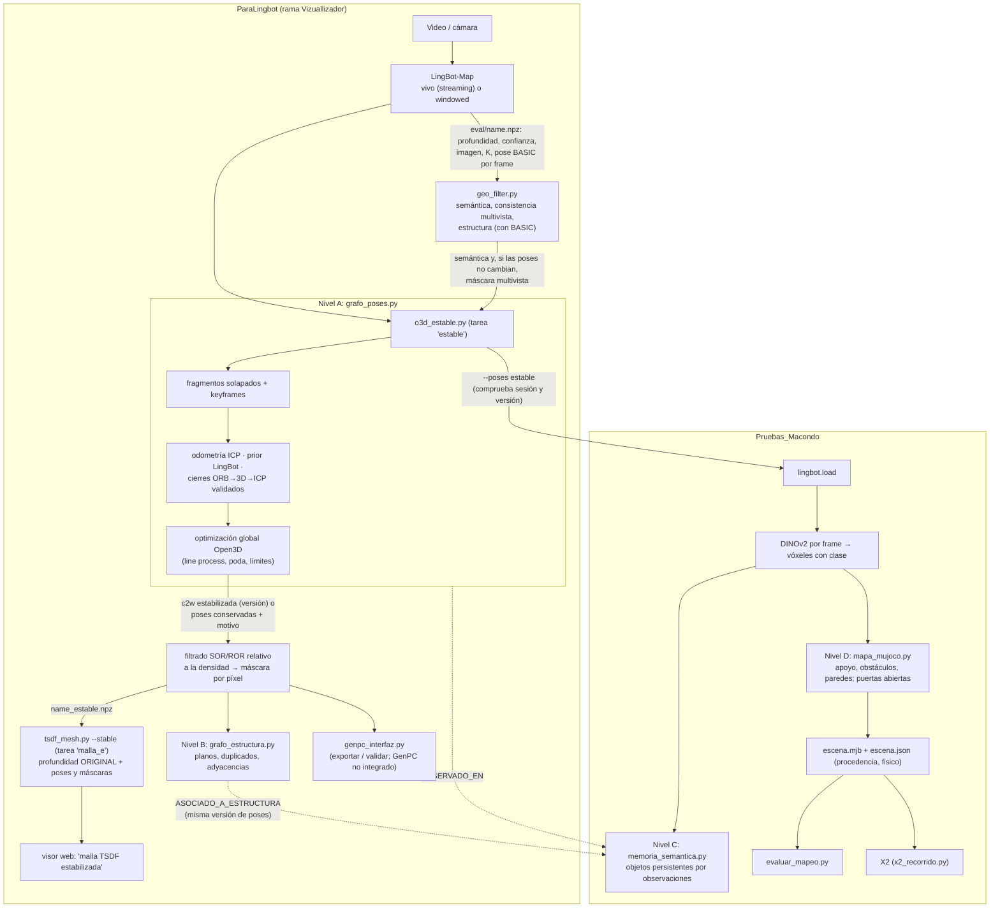

# Arquitectura jerárquica de grafos de ParaLingbot (2026-10-14)

Este documento describe cómo quedó organizado el paso de la reconstrucción de LingBot-Map a la geometría para MuJoCo: un grafo geométrico de poses antes del TSDF, un grafo estructural, una memoria semántica y una escena física. Explica qué existe de verdad en el código, qué se midió y qué falta.

Cada afirmación lleva su fuente: **[código]**, **[prueba]** ejecutada, **[doc]** documentación previa, **[inferencia]** o **[insuficiente]**.

Documentos de detalle:

| Tema | Documento |
|---|---|
| Nivel A: grafo de poses, optimización, decisión Open3D frente a GTSAM | [GRAFO_GEOMETRICO_Y_OPTIMIZACION.md](GRAFO_GEOMETRICO_Y_OPTIMIZACION.md) |
| Open3D antes del TSDF: auditoría del pipeline, comparación A/B/C/D, cómo reconstruir la TSDF | [PIPELINE_OPEN3D_TSDF.md](PIPELINE_OPEN3D_TSDF.md) |
| Nivel B: superficies duplicadas y grafo estructural | [VALIDACION_SUPERFICIES_DUPLICADAS.md](VALIDACION_SUPERFICIES_DUPLICADAS.md) |
| Nivel C: memoria semántica (Pruebas_Macondo) | [GRAFO_SEMANTICO_Y_MEMORIA.md](GRAFO_SEMANTICO_Y_MEMORIA.md) |
| Nivel D: escena física de MuJoCo (Pruebas_Macondo) | [VALIDACION_MUJOCO.md](VALIDACION_MUJOCO.md) |
| Poses por etapa, identificadores, versiones y dependencias | [CONTRATOS_ESPACIALES.md](CONTRATOS_ESPACIALES.md) |
| GenPC: interfaz de evaluación, no integrado | [PLAN_INTEGRACION_GENPC.md](PLAN_INTEGRACION_GENPC.md) |

## 1. Diagnóstico de lo que había

**Arquitectura previa** **[código]**:
- **LingBot-Map** guarda en `eval/<name>.npz`, por frame, la profundidad, la confianza, la imagen, los intrínsecos y la pose BASIC. No se pierde nada por frame, salvo el recorte cuadrado del video vertical.
- **Stella, HYBRID y STELLA** son poses de referencia; la geometría se registra siempre con BASIC.
- **No había registro entre fragmentos, cierre de ciclos ni optimización global.** Solo existían:
  - el reproceso windowed;
  - el filtro multivista (`geo_filter.py`), con una realineación por planos opcional y apagada;
  - el `--refine` del TSDF (ICP con escala por frame, después de integrar).
- **El TSDF** integra RGB-D por frame con las poses BASIC.
- **El gemelo de Macondo** vuelve a levantar la profundidad, sin identidad de objetos.

**Problemas demostrados:**

| Problema | Evidencia |
|---|---|
| Mezcla de poses BASIC y HYBRID en el gemelo: hasta 0.87 m y 6° | [prueba], corregido el 14/10 (`IncompatibleArtifacts`) |
| `tsdf_mesh.py` dividía `t_hit` por la norma del rayo; Open3D ya da z. `inlier5` salía bajo. | [prueba] fablab: 0.322 → 0.428. Corregido. |
| Open3D rechazaba en silencio un grafo no conectado | [prueba] fablab. Corregido: prior de LingBot y comprobación explícita. |
| Las paredes dobles son frames enteros corridos, no ruido de puntos | [doc] bitácora 2026-10-04 |
| ICP con escala por frame casi no recupera frames | [doc] bitácora 2026-10-01 |
| Las envolventes convexas de las escaleras tapaban el paso en MuJoCo | [prueba] corregido (nivel D) |

## 2. Arquitectura final



**Qué es un grafo de verdad y qué no.** Hay un solo optimizador, el del nivel A. Los niveles B, C y D son grafos de relaciones persistidos en JSON, sin optimización. La semántica nunca mueve la geometría. No se usa una base de datos de grafos: todo son archivos JSON y `.npz` por sesión, con identificadores y versiones (ver los contratos).

| Nivel | Nodos | Aristas o relaciones | Dónde |
|---|---|---|---|
| A, geométrico | fragmentos de 8 frames cada 4 | odometría ICP, prior LingBot, cierre (verificado, incierto) | `<name>_grafo.json` |
| B, estructural | planos dominantes conexos | POSIBLE_DUPLICADO_DE, PARALELA_A, DOS_CARAS_DE, AMBIGUA_CON, CERCA_DE, ADYACENTE_A, SOPORTA, OBSERVADO_DESDE | `<name>_estructura_grafo.json` |
| C, semántico | objetos (identidad por observaciones) | OBSERVADO_EN, CERCA_DE, SOBRE, ASOCIADO_A_ESTRUCTURA, CONTRADICCION; entre memorias MISMO_OBJETO_QUE, ALTERNATIVA, CANDIDATO_GEOMETRICO, PENDIENTE | `memoria_semantica.json` (Macondo) |
| D, físico | suelo, paredes, losas de apoyo, obstáculos, visuales | origen, estado, simplificación, colisión sí o no | `escena.json → capas.fisico` (Macondo) |

## 3. Decisiones técnicas

| Decisión | Por qué | Alternativa descartada |
|---|---|---|
| Grafo de Open3D, fuera de línea | Instalado, la necesidad medida es fuera de línea y el costo es de segundos a minutos | GTSAM/iSAM2: no instalado, sin necesidad incremental medida; el JSON queda listo para él |
| Fragmentos solapados en lugar de frames | Grafo de tamaño controlado (33–183 nodos); con frames ralos, el solape mide la odometría | Un nodo por frame: 735 nodos y odometría sin solape |
| Cierres por imagen (ORB) y luego 3D-3D, y luego ICP | La deriva deja las dos visitas fuera del alcance de un ICP desde las poses | ICP desde las poses: diverge (62° en la sesión 2) |
| Plausibilidad proporcional a lo recorrido | Frena coincidencias en zonas repetitivas que pasan lo visual y lo geométrico | Solo fitness o RMSE: aceptaba correrse un tramo entero |
| No deformar la odometría | Una corrección rígida no debe tapar errores de escala ni de forma | Aceptar cualquier solución que baje el residuo |
| La estabilización integra la profundidad original | No se inventa información de profundidad ni se arma un RGB-D falso desde una nube | Integrar la nube filtrada |
| Filtrado relativo a la densidad | Con un umbral único se borraban las superficies lejanas (9.7 % de una escena limpia) | SOR y ROR de Open3D con un radio único |
| Sin ajuste a planos en la TSDF estabilizada | Los planos son diagnóstico; reemplazar observaciones por planos puede tapar errores | El `depth_snap` del filtro |

## 4. Resultados

Detalle por sesión en [PIPELINE_OPEN3D_TSDF.md](PIPELINE_OPEN3D_TSDF.md#4-resultados-sobre-sesiones-reales).

| Qué | Resultado | Fuente |
|---|---|---|
| Pruebas sintéticas: deriva en un circuito | cierres verificados; error de cámara −95 % al final del recorrido; superficies duplicadas 5 → 0 | [prueba] |
| Pruebas sintéticas: pasillo repetitivo | 20 cierres falsos (que pasaron lo visual y lo geométrico) rechazados por plausibilidad | [prueba] |
| Pruebas sintéticas: ruido | 99.3 % de los atípicos enmascarados, 100 % de la superficie real conservada | [prueba] |
| 6 reconstrucciones reales (135–735 frames) | el grafo conserva las poses en las 6. En vivo, sin revisitas verificables. Offline, con 119 (fablab) y 30 (desnivel) cierres aceptados, la corrección rígida rompería la odometría: el error no es rígido. | [prueba] |
| TSDF con frames apartados | la estabilizada coincide mejor con la profundidad apartada en 2 de 3 reconstrucciones (fablab 0.466 frente a 0.449 de la base; sesión 1 windowed 0.415 frente a 0.320); en streaming gana la filtrada. El color queda igual o algo peor que la base. | [prueba] |
| Espesor de pared | sin corrección de poses, no cambia | [prueba] |
| Métrica `inlier5` | corregida (subestimaba ~0.1) | [prueba] |
| MuJoCo (sesión 1) | colisión espuria en el recorrido: 2.8 → 1.0 % (streaming) y 5.9 → 1.8 % (windowed); sin piso de colisión: 42 → 30 % (windowed) | [prueba] |
| Memoria semántica (sesión 1) | objetos con identidad estable; reubicados con otras poses sin DINOv2 (0.44 m de mediana, como la diferencia de poses); entre streaming y windowed, 19 iguales, 15 alternativas y 10 contradicciones, sin fundir nada solo por parecido visual | [prueba] |
| Rendimiento | estabilización: 80–160 s y 1.6–1.9 GB (135 frames), 186 s y 3.9 GB (476), 294 s y 6.6 GB (735). TSDF: 26–48 s / 202 s / 488 s (hasta 7.5 GB). Grafo: 33–183 nodos, 57–802 aristas. | [prueba] |
| Prueba de punta a punta con un video nuevo (fablab, `run_mapeo_vivo.sh` de Macondo) | Mapeo en vivo con Stella (85 frames). Primera corrección real del grafo: 2 y 7 cierres verificados, poses corregidas (≤ 0.034 unidades, 1.5°) sin romper la odometría. Gemelos con `--poses estable` sin el filtro ni la estructura (son de las BASIC). Memoria: 58 objetos por escena, 30 iguales entre streaming y windowed. MuJoCo: 0 % de colisión espuria, 1–2 % sin piso de colisión. Con la misma huella, la TSDF no se reintegró al retomar. | [prueba] |
| Actualizar el mapa tras cambiar las poses | TSDF: reintegración completa (26–488 s). Gemelo de Macondo: ~10 s. Memoria: `reubicar` en ~3 s, sin DINOv2. Con las mismas entradas, la TSDF no se reintegra (huella). | [prueba] |

**Actualización del 2026-10-15:**
- **Pruebas de punta a punta:** desnivel y pasillo en vivo, además del fablab ([VALIDACION_MUJOCO.md](VALIDACION_MUJOCO.md)).
- **Nube densa estabilizada** (tarea `nube_e`) y cámaras estabilizadas para el visor, porque las nubes que se miraban eran las de diagnóstico ([PIPELINE_OPEN3D_TSDF.md](PIPELINE_OPEN3D_TSDF.md) §6).
- **Desnivel original de 735 frames:** el grafo rechazó corregir sus poses.

## 5. Limitaciones

- **Las sesiones reales del desnivel no tienen revisitas verificables.**
  - En vivo y en windowed, los cierres ORB entre la ida y la vuelta no pasan la verificación: se ven en sentidos opuestos, o la superficie común queda fuera de la profundidad usable.
  - En el desnivel offline, la corrección se rechaza porque deformaría la odometría.
  - En estos datos el grafo conserva las poses y reporta por qué. **[prueba]**
- **La escala no está calibrada.** Es monocular (Depth Anything V2 en Macondo). El grafo la mide entre fragmentos y no la corrige. **[código]**
- **La TSDF se reintegra entera cuando cambian las poses.** Por fragmento queda pendiente. **[código]**
- **Sin referencia externa** (ground truth) de estos edificios: las métricas reales son de consistencia o de reproyección en frames apartados, no de error absoluto. **[insuficiente]**
- **GenPC no está integrado.** **[código]**
- **Cuando el grafo corrige las poses, la escena de MuJoCo queda sin paredes de colisión**: la estructura del filtro es de las poses BASIC y no se puede usar. El nivel B ya tiene las paredes en las poses estabilizadas; llevarlas a MuJoCo es el siguiente paso. **[prueba]**
- **Las losas de apoyo heredan los errores de etiqueta de DINOv2**: en el fablab, una superficie a 0.85 m (probablemente una mesa) quedó como piso. **[prueba]**

## 6. Reproducir

```bash
# ParaLingbot: estabilización + malla estabilizada (también desde el modal "construir mapas" del visor)
python3 src/mapas/build_maps.py <prueba> --npz eval/<name>.npz --tasks filtro,estable,nube_e,malla_e
# Comparación con frames apartados (1 de cada 8)
python3 src/mapas/tsdf_mesh.py <prueba>/eval/<name>.npz --out <prueba>/exports/variantes/estable/<name>_filtrada_h8 --filter <filtro> --holdout_every 8
python3 src/mapas/o3d_estable.py <prueba>/eval/<name>.npz --out <prueba>/exports/variantes/estable/<name>_h8 --filter <filtro> --holdout_every 8
python3 src/mapas/tsdf_mesh.py <prueba>/eval/<name>.npz --out <prueba>/exports/variantes/estable/<name>_estable_h8 --stable <prueba>/exports/variantes/estable/<name>_h8_estable.npz --holdout_every 8
python3 src/mapas/comparar_geometria.py <prueba> --name <name>
# Pruebas
PYTEST_DISABLE_PLUGIN_AUTOLOAD=1 python3 -m pytest test -q -p no:cacheprovider     # con ROS 2 cargado para test_ros2_bridge
# Pruebas_Macondo: gemelo con poses estabilizadas, memoria y evaluación
./run_gemelo_lingbot.sh construir --npz <prueba>/eval/<name>.npz --poses estable --out mapas/<escena>
.venv/bin/python -m vision.memoria_semantica construir mapas/<escena>
.venv/bin/python -m vision.evaluar_mapeo mapas/<escena> --out <carpeta>
```
