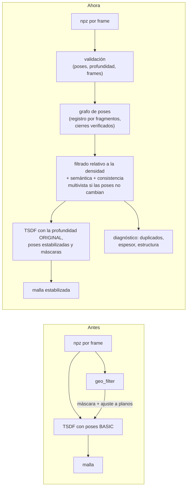

# Open3D antes del TSDF: auditoría, nuevo orden y comparación

## 1. Auditoría: dónde nacen y se funden las nubes, y qué recibe el TSDF

| Pregunta | Respuesta | Fuente |
|---|---|---|
| ¿Hay una nube por frame? | No se guarda como nube. Se guarda lo necesario para levantarla: profundidad por píxel (518 × 518), confianza, imagen, intrínsecos y pose de cada frame real, en `eval/<name>.npz`. | [código] `process_and_view.py`, `live_server.py` |
| ¿Cómo se obtienen las poses? | Cabeza de cámara de LingBot-Map (BASIC): `extrinsic` es w2c. En vivo se graban además `pose_ref_stella`, `pose_ref_hybrid` y `pose_ref_stella_corr` como referencias, y `pose_source` dice con cuál se registró la geometría (0 = BASIC en las sesiones medidas). | [código] [prueba] |
| ¿Dónde se acumulan o funden las nubes? | `export_dense_cloud.py` (vóxel), `npz_to_webgl.py` (cruda o densa), `register_map.py` (`MapAccumulator`, con poses de referencia), el filtro (`geo_filter.py`: nube de trabajo para la estructura) y, del lado de Macondo, `lingbot.lift` / `fuse`. Todas parten de la profundidad por frame. | [código] |
| ¿Dónde corre el TSDF y qué recibe? | `tsdf_mesh.py` (tareas `malla`, `malla_f`): `ScalableTSDFVolume` de Open3D. **Integra RGB-D por frame** (imagen, profundidad con confianza ≥ p35 y ≤ p97, intrínsecos y pose BASIC), no una nube fusionada. Con `--filter` aplica la máscara del filtro y la profundidad ajustada a planos. | [código] |
| ¿Había registro, cierres u optimización global? | No. Solo el `--refine` del propio TSDF (ICP punto a punto con escala, por frame, contra una malla de consenso; ayudó poco según la bitácora del 2026-10-01) y la realineación por planos del filtro (`--align`, apagada). | [código] [doc] |
| ¿Se mezclan streaming y windowed? | Cada `.npz` tiene su propio filtro (`<stem>_filtro.npz`). El gemelo de Macondo mezclaba poses (BASIC/HYBRID) y quedó bloqueado el 14/10. `o3d_estable.py` y `tsdf_mesh.py --stable` comprueban frames y poses de entrada. | [código] [prueba] |
| ¿Qué usa el gemelo de MuJoCo? | El `.npz` (profundidad y poses), el filtro y la estructura (si son de las mismas poses) y las etiquetas DINOv2 propias. No usa las mallas. | [código] |

### Qué información se pierde antes del TSDF

| Pérdida | Dónde | ¿Recuperable? |
|---|---|---|
| ~44 % de cada imagen (recorte cuadrado del video vertical) | carga de LingBot | no, desde el `.npz` |
| Profundidad con confianza baja (< p35) y la más lejana (> p97) | `tsdf_mesh.frame` | sí: queda en el `.npz` |
| Metadatos de la sesión en el reproceso windowed (Stella, stamps) | `process_and_view.py` | la sesión en vivo los conserva; se enlazan por `source_index` |
| Malla de la prueba 4: solo quedó la `.glb` (sin `.ply` ni `_info.json`) | archivos existentes | se reconstruye desde el `.npz` |

**Nada impide reintegrar con poses corregidas.** La profundidad, los intrínsecos y la pose de cada frame están intactos, así que la estabilización no necesita inventar visibilidad ni profundidad.

## 2. El nuevo orden



**En el flujo real.** `build_maps.py --tasks filtro,estable,malla_e` corre `filtro`, después `estable` (Open3D) y después `malla_e` (TSDF), en ese orden fijo. El visor ofrece las dos tareas nuevas y lista «malla TSDF estabilizada (Open3D)». Las tareas anteriores (`malla`, `malla_f`) quedan como estaban, y las mallas viejas se conservan.

**Qué hace cada etapa.** Detalle en [GRAFO_GEOMETRICO_Y_OPTIMIZACION.md](GRAFO_GEOMETRICO_Y_OPTIMIZACION.md) y [VALIDACION_SUPERFICIES_DUPLICADAS.md](VALIDACION_SUPERFICIES_DUPLICADAS.md).

**Filtrado** (configurable, con los parámetros en el metadato):
- **SOR y ROR relativos a la densidad esperada de cada vóxel** (profundidad × stride / fx). Con un umbral único, Open3D borraba el 9.7 % de una escena sintética limpia, sobre todo superficies lejanas que se muestrean más ralas.
- **Semántica del filtro geométrico:** personas, animales y cielo. No depende de las poses.
- **Máscara de consistencia multivista del filtro**, solo si el grafo conservó las poses: es de esas poses. El ajuste a planos (`depth_snap`) no se usa, porque reemplazaría observaciones por la estructura.
- **Normales orientadas hacia la cámara** que vio cada vóxel, en `_nube_estable.ply`.

**TSDF** (`tsdf_mesh.py --stable`):
- comprueba que la estabilización sea de esta reconstrucción;
- integra cada frame con su profundidad original, la pose estabilizada y las máscaras;
- guarda `tipo_geometria`, `version_poses` y `huella_entradas`;
- con `--skip_if_same` no reintegra si nada cambió;
- con frames apartados, mide también con las poses originales.

## 3. Una corrección en la métrica de las mallas

`create_rays_pinhole` de Open3D da direcciones **sin normalizar**, con componente z = 1 en la cámara y por el centro del píxel. Por eso `t_hit` ya es la profundidad z.

`tsdf_mesh.py` (en `agreement` y `novel_views`) dividía `t_hit` por la norma de la dirección. Así la profundidad de la malla salía hasta ~30 % corta en las esquinas, y `inlier5` (coincidencia a menos de 5 % con la profundidad de un frame) tenía un techo artificial.

Medido sobre la malla guardada del fablab (`final_m2_malla.ply`, paso 2), en 80 frames:

| | Fórmula anterior | Corregida |
|---|---|---|
| `inlier5` medio | 0.322 | 0.428 |
| Error relativo mediano | 7.2 % | 4.2 % |
| Frames con `inlier5` < 0.2 | 27 | 30 |

**Cómo leerlo.** La consistencia estaba subestimada en ~0.1. La conclusión de la bitácora del 2026-10-01 se mantiene: hay tramos enteros que no coinciden (los frames por debajo de 0.2 siguen ahí). Las cifras de `inlier5` de la bitácora anteriores al 14/10 llevan ese sesgo. Las mallas no cambian: solo la medida.

## 4. Resultados sobre sesiones reales

Segunda pasada del 14/10, con el código final. Todo en la RTX 2000 Ada de 8 GB / 30 GB de RAM, con Open3D y el TSDF en CPU.

### Grafo de poses y estabilización (flujo real: `build_maps.py --tasks estable,malla_e`)

| Reconstrucción | Frames | Nodos / aristas | Cierres: aceptados / podados / rechazados | Decisión | Puntos quitados | Tiempo, RAM pico |
|---|---|---|---|---|---|---|
| Sesión 1, streaming | 135 | 33 / 64 | 0 / 0 / 32 | consistentes: se conservan | 1.8 % | 93 s, 1.6 GB |
| Sesión 1, windowed | 135 | 33 / 69 | 0 / 0 / 37 | consistentes: se conservan | 2.3 % | 89 s, 1.9 GB |
| Sesión 2, streaming | 136 | 33 / 57 | 0 / 0 / 25 | consistentes: se conservan | 1.7 % | 80 s, 1.6 GB |
| Sesión 2, windowed | 136 | 33 / 57 | 0 / 0 / 27 | consistentes: se conservan | 2.2 % | 158 s, 1.7 GB |
| Fablab (prueba 3, offline windowed) | 476 | 118 / 567 | 119 / 65 / 152 | corrección **rechazada**: deformaría la odometría (6 aristas) | 1.1 % | 186 s, 3.9 GB |
| Desnivel (prueba 4, offline windowed) | 735 | 183 / 786 | 30 / 30 / 388 | corrección **rechazada**: deformaría la odometría (5 aristas) | 1.6 % | 294 s, 6.6 GB |

La malla TSDF estabilizada tarda 26–48 s en las sesiones de 135 frames, 202 s en el fablab y 488 s en el desnivel (hasta 7.5 GB de RAM).

**Lectura** **[prueba]**:
- **Sesiones en vivo:** los cierres entre la ida y la vuelta no pasan la verificación. Hay dos causas:
  - se ven en sentidos opuestos, así que ORB no encuentra correspondencias;
  - o lo común está lejos, fuera de la profundidad usable del TSDF.

  En la sesión 2 windowed, la de la deriva vertical de 1.84 m, el cierre de la entrada a la vuelta sí pasó la verificación visual (27–29 correspondencias 3D). Esas correspondencias estiman una deriva de ~13° y 0.3–0.4 unidades a lo largo de 17 unidades de recorrido. Pero las dos nubes casi no se solapan dentro de la profundidad usable (fitness 0.06), y el ICP desde esa estimación termina en 24–30°: el cierre se rechaza. La deriva queda **detectada y cuantificada, no corregida**.
- **Videos offline (fablab, desnivel):** sí hay cientos de cierres verificados, pero la solución rígida que los satisface rompe la geometría local.

  El máximo que estiman los cierres visuales en el desnivel (23°) se da entre fragmentos separados por solo 0.79 unidades de recorrido: más probablemente un conjunto de correspondencias erróneo que deriva, y el grafo no lo usa.

  Esto confirma con otra herramienta la hipótesis del 2026-10-01: el desacuerdo entre revisitas no es rígido (escala o forma de la profundidad). En los seis casos el grafo conservó las poses, y dice por qué.

### TSDF: línea base, filtrada y estabilizada (1 de cada 8 frames apartados, medidos en esos frames)

| Reconstrucción | Variante | Triángulos | inlier5 | PSNR | SSIM | Espesor de pared (× prof. mediana) / fuera de la lámina |
|---|---|---|---|---|---|---|
| Fablab (60 frames apartados) | base (sin filtro) | 1.31 M | 0.449 | 12.57 | 0.447 | 0.188 / 0.47 |
| | filtrada (máscara + ajuste a planos) | 1.16 M | 0.337 | **12.63** | **0.463** | **0.145 / 0.30** ⚠ |
| | **estabilizada** | 1.19 M | **0.466** | 12.61 | 0.447 | 0.185 / 0.45 |
| Sesión 1 windowed (17) | base | 3.07 M | 0.320 | 9.58 | **0.304** | 0.160 / 0.34 |
| | filtrada | 2.19 M | 0.307 | 9.49 | 0.276 | **0.095 / 0.22** ⚠ |
| | **estabilizada** | 2.21 M | **0.415** | **9.72** | 0.299 | 0.147 / 0.30 |
| Sesión 1 streaming (17) | base | 3.17 M | 0.240 | **9.57** | **0.299** | 0.167 / 0.47 |
| | filtrada | 1.76 M | **0.391** | 8.53 | 0.210 | **0.131 / 0.37** ⚠ |
| | **estabilizada** | 2.04 M | 0.314 | 8.38 | 0.202 | 0.158 / 0.37 |

⚠ El ajuste a planos lleva la profundidad justo a los planos contra los que se mide el espesor: la métrica es en parte circular (bitácora 2026-10-04).

La línea base y la filtrada del fablab reproducen exactamente el PSNR y el SSIM de la bitácora del 2026-10-04 (12.57 / 0.447 y 12.63 / 0.463). El `inlier5` difiere por la corrección de la fórmula (sección 3). **[prueba]**

**Lectura:**
- **Profundidad en frames apartados (`inlier5`):** la estabilizada (sin ajuste a planos, con la máscara multivista del filtro y el filtrado de Open3D) es la que mejor coincide en 2 de 3 reconstrucciones (+0.02 y +0.10 sobre la base). En streaming gana la filtrada.
- **Color:** la estabilizada iguala o mejora a la filtrada en 2 de 3. En streaming ninguna variante enmascarada alcanza a la base, porque quedan menos superficies y más píxeles sin malla.
- **Espesor de pared:** sin corrección de poses no cambia frente a la base. Las paredes dobles de estos videos son frames enteros corridos, y solo moverlos las adelgaza (bitácora 2026-10-04). El grafo no encontró una corrección rígida válida.

**[prueba]** **[inferencia]**

**Límites de esta medición:**
- La máscara multivista del filtro usa la profundidad de todos los frames, apartados incluidos, así que puede favorecer a las variantes filtrada y estabilizada.
- Hay una corrida por variante.
- No hay referencia externa.

**[insuficiente]**

## 5. Reconstruir la TSDF

```bash
# filtro (semántica, consistencia, estructura), estabilización y malla, en orden
python3 src/mapas/build_maps.py <prueba> --npz eval/<name>.npz --tasks filtro,estable,nube_e,malla_e
# rehacer aunque exista (otra configuración): --force; malla_e solo reintegra si cambió su huella de entradas
python3 src/mapas/o3d_estable.py --help        # parámetros (stride, fragmentos, umbrales, filtros, diagnóstico)
python3 src/mapas/comparar_geometria.py <prueba> --name <name>   # tras las variantes con --holdout_every 8
```

Las mallas anteriores (`*_malla.*`, `*_filtrado_malla.*`) quedan como referencia; no se consideran válidas solo por existir.

## 6. Nube densa estabilizada y cámaras para el visor (2026-10-15)

**El problema.** Las nubes de las pruebas del 14/10 se veían menos densas y más finas que las de las primeras pruebas, y la muestra del desnivel no conservaba igual la referencia espacial.

**Causas medidas:**

| Prueba | Frames | Nube densa (`_denso.ply`) | Nube de diagnóstico de Open3D (`_nube_estable.ply`) | `_cameras.json` |
|---|---|---|---|---|
| Desnivel offline (prueba 4, `final_m4`) | 735 | 12.7 M | 3.6 M | sí |
| Fablab offline (prueba 3, `final_m2`) | 476 | 13.8 M | 1.5 M | sí |
| Desnivel en vivo (`sesion_20261014_235201`) | 134 | no se generaba | 0.83 M | no |
| Fablab en vivo (`sesion_20261014_232929`) | 85 | no se generaba | 0.43 M | no |

1. **El flujo de las sesiones nuevas no generaba la nube densa ni las cámaras.** El lanzador de Pruebas_Macondo pedía solo `estable,malla_e`. Sin `_cameras.json`, el visor no orienta ni escala las capas, ni dibuja el recorrido.
2. **`_nube_estable.ply` es una nube de diagnóstico:**
   - toma 1 de cada 16 píxeles (stride 4);
   - la funde en vóxeles de la profundidad mediana / 150;
   - sirve para medir duplicados y espesores, no para mirar.
3. **El vivo graba menos frames:** menos de 2 por segundo. El mismo video, offline, da 735 frames, y el windowed con ventana 24 los registra mejor.

**Solución** (Open3D se mantiene):
- **`export_dense_cloud.py --stable <base>`:**
  - la nube densa de siempre, todos los píxeles, con los mismos `voxel_rel` y percentil de confianza;
  - usa las poses estabilizadas y la máscara de Open3D, y la del filtro solo si las poses no cambiaron;
  - comprueba que la estabilización sea de esta reconstrucción;
  - en el `_info.json` anota `estable`, `version_poses` y `tipo_geometria`.
- **Tarea `nube_e` de `build_maps.py`:** escribe `exports/estable/<name>_estable_denso.ply`. La tarea `estable` va antes.
- **`o3d_estable.py` escribe `exports/estable/<name>_cameras.json`:** son las cámaras estabilizadas, en el formato de `npz_to_webgl`.
- **El catálogo del visor:**
  - busca primero esas cámaras para las capas estabilizadas;
  - lista «nube densa estabilizada (Open3D)»;
  - llama a las otras dos «nube de diagnóstico … (submuestreada)».

**Resultado** (15/10, `nube_e` en todas las pruebas; vóxel por defecto de `build_maps`, 0.0004 de la diagonal):

| Prueba | Frames | Nube densa | **Nube densa estabilizada** | Diagnóstico |
|---|---|---|---|---|
| Desnivel offline (`final_m4`) | 735 | 12.7 M (vóxel 0.0005, del 3/10) | **18.7 M** | 3.6 M |
| Fablab offline (`final_m2`) | 476 | 13.8 M (vóxel 0.0005, del 19/9) | **19.8 M** | 1.5 M |
| Fablab en vivo, streaming / windowed | 86 | 7.2 / 7.4 M | **6.9 / 7.0 M** | 0.43 / 0.40 M |
| Desnivel en vivo, streaming / windowed | 134 | 5.6 / 6.8 M | **4.0 / 5.3 M** | 0.83 / 0.79 M |
| Pasillo en vivo, streaming / windowed | 106 | 1.5 / 1.1 M | **1.1 / 0.81 M** | 0.63 / 0.70 M |

**Cómo leer las cifras:**
- **Pruebas offline:** la estabilizada supera a la densa vieja solo por el vóxel más fino. Antes del vóxel tiene un 13 % menos de puntos (prueba 4: 112 M contra 128 M) por las máscaras.
- **Desnivel y pasillo en vivo:** la máscara del filtro geométrico quita hasta el 56 % de los píxeles: cielo, baja confianza y bordes.
- **Fablab:** esa máscara no se usa, porque el grafo corrigió las poses.
- **Pasillo:** el vóxel relativo a la diagonal sale grueso en una escena de 66 m de recorrido. Pendiente: hacerlo relativo a la profundidad, como el del filtrado.

**Visor:** el catálogo lista las 7 nubes densas estabilizadas con sus cámaras, verificado en `/api/explorer` tras reiniciar `live_server.py`, que cachea el código del catálogo al arrancar.

**Para la mejor referencia espacial del desnivel:** usar el mapa offline de 735 frames. Su estabilización Open3D rechazó corregir las poses (deformaría 5 aristas de odometría), así que conserva la geometría de las primeras pruebas, ahora con su nube densa estabilizada.

## 7. Registro multivía del tutorial de Open3D y permanencia del piso (2026-10-15)

**Pedido.** Usar el registro multivía del tutorial de Open3D ([pipelines/multiway_registration](https://www.open3d.org/docs/latest/tutorial/pipelines/multiway_registration.html)) y su nube combinada para corregir superficies. El foco es la **permanencia espacial del piso**, que en las nubes suele salir irregular.

**Métrica nueva: permanencia del piso** (`floor_permanence` en `o3d_estable.py`; va en el informe `_estable.json`, en `diagnostico.<versión>.resumen.permanencia_piso` y en `piso`):
- se toman solo los puntos del grupo `piso` del filtro (las escaleras no entran);
- se dividen en celdas en planta de 0.03 × profundidad mediana;
- **diferencia entre visitas:** en cada celda, la altura mediana del piso por visita (bloques de 16 frames), y cuánto difieren las visitas entre sí. Es lo que una deriva separa en capas;
- **celdas separadas:** la fracción de celdas cuyas visitas difieren más de media celda;
- **espesor:** p10–p90 de la altura dentro de cada celda.

**Qué se implementó:**
- **`registro="multiway"`** (`GP.PoseGraph.solve_multiway`; tarea `multiway`). Sigue el tutorial:
  - `pairwise_registration`: ICP punto a plano grueso, a 15 vóxeles, y fino, a 1.5;
  - odometría cierta entre fragmentos consecutivos y cierres inciertos;
  - `global_optimization` con `edge_prune_threshold` 0.25 y el nodo 0 como referencia;
  - **nube combinada** `_combinada.ply`: cada fragmento transformado por la pose de su nodo, sumados y submuestreados.
- **Diferencias con el tutorial**, porque tal cual rompe los mapas reales:
  - solo se registran los pares que se solapan;
  - un registro por pares implausible, o que puede deslizar sobre un plano, no entra (la odometría usa entonces la pose de LingBot);
  - la solución se rechaza si se aparta de LingBot entre fragmentos vecinos más de 3 vóxeles o 1.5°.
- **`alinear_piso`** (`align_floor`): el registro multivía restringido al piso.
  - Se combina el piso de todos los frames: por celda, la mediana de las alturas medianas de cada frame.
  - Cada frame se ajusta a ese piso en altura e inclinación, los 3 grados de libertad que el piso fija. Se usan mínimos cuadrados recortados, con correcciones acotadas (0.3 × profundidad mediana y 3° por eje), una mediana móvil de 5 frames y 3 iteraciones.
  - Los frames sin piso toman la corrección interpolada de sus vecinos.
- **Tareas nuevas en `build_maps`:**
  - `multiway`: multivía con guardas y alineación del piso; sus derivadas son `nube_m` y `malla_m`;
  - `piso`: grafo verificado y alineación del piso; sus derivadas son `nube_p` y `malla_p`.
  - Las dos están en el visor. `estable` no cambia.

**Resultados (desnivel; cm con la escala de cada reconstrucción, sin calibrar):**

| Reconstrucción | Versión | Piso: diferencia entre visitas p90 | Celdas separadas | Espesor mediano del piso |
|---|---|---|---|---|
| Hoy, streaming (136 frames) | original | 165 cm | 73.8 % | 8.2 cm |
| | multivía (corrigió) | 162 cm | **87.4 %** | **11.5 cm** |
| | multivía + piso | 100 cm | 58.0 % | 9.5 cm |
| | **verificado + piso** | 103 cm | **55.4 %** | **7.8 cm** |
| Hoy, windowed | original | 78 cm | 97.7 % | 14.3 cm |
| | multivía rechazado (4.1°) + piso | **24 cm** | **66.4 %** | **8.3 cm** |
| Original (735 frames) | original | 43 cm | 81.5 % | 13.2 cm |
| | multivía rechazado (13.6°) + piso | **15 cm** | **40.1 %** | **5.5 cm** |

**Qué se aprendió:**
- **El tutorial tal cual rompe los mapas reales.** En la sesión de hoy, el ICP entre fragmentos resbaló en piso y escaleras, y la cadena de odometría acumuló 54°: las cámaras se movieron unas 3 unidades.
- **Con guardas,** el multivía solo corrigió la sesión de streaming, y ahí empeoró el piso. En las otras dos la guarda lo rechazó.
- En la escena sintética con deriva al volver, el multivía sí deja el piso en una sola capa (`test_multiway_registration_closes_the_drift_and_keeps_the_floor_in_one_layer`).
- **Lo que mejora el piso en los datos reales es la alineación por frame.** En el desnivel original, el espesor del piso bajó de 13 a 5.5 cm, y las celdas separadas del 82 al 40 %.
- **El p90 de la diferencia entre visitas incluye celdas con niveles reales distintos,** porque el desnivel tiene escalones. La mediana y la fracción de celdas separadas son más robustas.

**Costo y advertencias:**
- **Las paredes empeoran apenas:** el espesor local de todas las superficies sube un 5 % (0.87 → 0.91 cm en el original), y la cantidad de superficies duplicadas no cambia.
- **La mayoría de los frames toca el tope de inclinación de 3° por eje.** La corrección de altura de las cámaras tiene una mediana de 5–17 cm y un p90 de 40–78 cm.
- **Lectura [inferencia]:** la profundidad monocular inclina y desplaza el piso de manera distinta en cada frame. Girar el frame entero lo compensa en el piso, pero no es el modelo correcto del error. El siguiente paso es corregir la **escala y el desfase de la profundidad de cada frame** contra el piso combinado, y no su pose. Eso también ordenaría las paredes.
- **Con las poses cambiadas, el gemelo de MuJoCo pierde las paredes del filtro de LingBot,** porque son de las poses BASIC. Por eso `estable` no cambia, y la alineación del piso queda como variante.

