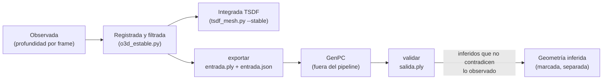

# Plan de integración de GenPC (completado de geometría)

**Estado: GenPC no está integrado ni instalado.** Lo que existe es la interfaz para evaluarlo después de estabilizar la geometría observada: [`src/mapas/genpc_interfaz.py`](../src/mapas/genpc_interfaz.py).

## Por qué después y por qué aparte

Un completado generativo produce superficies plausibles, no medidas. Si entrara antes de validar el registro, taparía con geometría inventada los mismos errores que se quieren ver: paredes dobles, frames corridos, deriva.

Por eso el orden es:

GenPC no se usa para corregir errores de registro: eso lo resuelve el grafo de poses ([GRAFO_GEOMETRICO_Y_OPTIMIZACION.md](GRAFO_GEOMETRICO_Y_OPTIMIZACION.md)).

## Contrato

**Entrada** (`exportar`):
- `entrada.ply`: la nube estabilizada, con color y normales orientadas hacia las cámaras.
- `entrada.json`: procedencia (observada, registrada y filtrada), versión de poses, sesión, unidades (del modelo, sin escala métrica), marco y cámaras.

**Salida esperada** (`salida.ply`): todos los puntos de entrada sin moverlos, más los puntos nuevos.

**Validación** (`validar` → `validacion.json`):

| Medida | Qué detecta |
|---|---|
| `inferidos` | puntos que no estaban en la entrada (a más de medio vóxel de un punto observado) |
| `inferidos_en_espacio_libre` | inferidos que alguna cámara vio libres, porque vio una superficie más lejos a través de ellos: una puerta cerrada, un pasillo tapado, una pared inventada |
| `observaciones_perdidas` | observaciones que el completado movió o borró (no debe pasar) |
| `voxeles_nuevos_validos` | completitud ganada sin contradecir lo observado |
| `aceptable` | menos del 1 % de inferidos en espacio libre y ninguna observación perdida |

Un punto inferido nunca pasa a ser geometría física confirmada. Si entra en MuJoCo, debe hacerlo marcado como inferido (`escena.json → capas.fisico`, `estado: "inferido"`) y con la decisión documentada.

## Prueba

`test/test_o3d_estable.py::test_genpc_interface_flags_inferred_geometry_that_closes_a_door` arma una habitación sintética con una puerta y una pared exterior detrás, que las cámaras ven a través de la puerta. Agrega dos rellenos:

- **En la puerta:** sale contradicción en más del 80 % de los puntos.
- **Dentro de un obstáculo,** donde nadie vio espacio libre: menos del 5 %.

## Pendiente para integrar GenPC de verdad

1. Elegir el modelo y comprobar su licencia, su versión y que corra en la GPU de 8 GB junto al resto. No se instaló nada.
2. Definir qué regiones se le piden. Las que la cámara nunca vio son las únicas candidatas, porque lo visto libre no se completa.
3. Medir sobre las pruebas reales:
   - ganancia de completitud;
   - fracción de inferidos en espacio libre;
   - efecto sobre el modelo físico: aperturas cerradas y obstáculos deformados.
4. Si se acepta, llevar el origen `inferido` hasta MuJoCo sin confundirlo con lo observado.
