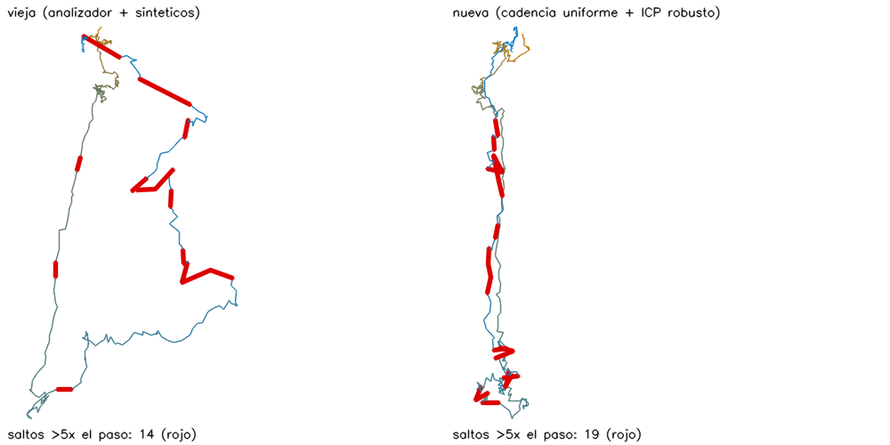

# Recapitulación de errores y guía de auditoría

**Proyecto:** ParaLingbot (reconstrucción 3D con una cámara RGB, sobre LingBot-Map) y su gemelo digital en MuJoCo (repositorio Pruebas_Macondo).
**Fecha:** 17 de octubre de 2026.
**Autor de la investigación:** Josaed-A.

Este documento tiene dos partes:

- **Parte 1 (para el autor):** recapitula los errores que el autor señaló entre el 24/08 y el 17/10/2026, explica por qué el resultado todavía no cumple el objetivo y cuenta cuántas veces se repitieron las mismas pruebas y qué se cambió en cada una.
- **Parte 2 (para el tutor de tesis):** es una guía para auditar el trabajo de forma estricta: qué se afirma, con qué evidencia, cómo verificarlo, qué no se puede afirmar y qué falta.

**Cómo se armó:**
- **Mensajes del autor:** los 156 de las tres sesiones de trabajo en las que se hizo la investigación (24/08–05/10 en ParaLingbot; 13/10–17/10 en Pruebas_Macondo).
- **Documentación:** la bitácora técnica del [README](../README.md) (append-only) y los documentos de `docs/` de los dos repositorios.
- **Mediciones de hoy:** las corridas del 17/10, cuyos archivos están en [`docs/auditoria/`](auditoria/).

Cada cifra lleva su fuente. Donde un conteo es aproximado se dice, junto con la forma en que se contó.

---

## Declaración sobre el uso de inteligencia artificial

La implementación del código, la ejecución de las corridas y la redacción de la mayor parte de la documentación técnica las hizo un asistente de IA (Claude Code, de Anthropic), dirigido por el autor.

**El autor:**
- definió los objetivos, las preguntas, las herramientas a integrar y las reglas del proceso;
- revisó los resultados y señaló los errores que se listan en la Parte 1.

El tutor debe evaluar el trabajo sabiendo esto. Las decisiones técnicas que tomó el asistente sin indicación expresa están marcadas como tales cuando importan, por ejemplo en los errores propios del §1.3.

---

# Parte 1. Recapitulación

## 1.1 El objetivo

El objetivo se fue precisando en tres momentos:

1. **ParaLingbot, desde el 23/08.** Usar una cámara RGB común como un "sensor RGB-D virtual" con LingBot-Map, para el robot de búsqueda y rescate del proyecto GARDIAN, en hardware modesto (GPU de 8 GB). Sin abandonar LingBot-Map: reducir su costo y mejorar la coherencia del mapa.

2. **Gemelo para humanoides, desde el 14/10.** En palabras del autor:

   > "Quiero que el sistema pueda transformar observaciones de espacios reales en representaciones geométricas suficientemente fieles para entrenar y evaluar humanoides en MuJoCo. [...] Lo que NO es aceptable es que el entorno final se reduzca a puntos dispersos, ruido geométrico, paredes desplazadas, superficies duplicadas o volúmenes que no representan adecuadamente la estructura real del espacio."

3. **Regla permanente, desde el 17/10.** El gemelo se construye por capas y pasos:
   1. **Mapeo con ParaLingbot:** Stella, filtros, flujo óptico; nunca LingBot crudo.
   2. **Estabilización:** Open3D, grafo de poses, nube combinada.
   3. **Malla simple.**
   4. **DINOv2 sobre la malla.**
   5. **Gemelo en MuJoCo** con el mapa ya procesado.

## 1.2 Errores que el autor señaló, en orden

Fechas en hora local del equipo. Estados posibles:
- **resuelto:** la causa se corrigió y se verificó;
- **parcial:** mejoró pero no se cumple lo pedido;
- **abierto:** sin solución.

| # | Fecha | Lo que señalaste | Causa encontrada | Qué se hizo | Estado |
|---|---|---|---|---|---|
| 1 | 15/09 | Los comandos del repositorio original no funcionan (`/path/to/lingbot-map.pt`) | Ruta de ejemplo del README de upstream | Guía de comandos de esta máquina | resuelto |
| 2 | 15/09 | `CUDA-capable device(s) is/are busy or unavailable` | Suspensión del equipo con procesos CUDA vivos (`PreserveVideoMemoryAllocations=0`) | Chequeo previo (`gpu_preflight.sh`), lanzador que bloquea la suspensión (`run_gpu.sh`) y parámetro del driver | resuelto |
| 3 | 15/09 | "¿Qué se necesita para mejorar el resultado? ¿Es problema de la muestra?" | Video vertical (se pierde ~44 % de cada imagen en el recorte cuadrado), desenfoque, parámetros reducidos para 8 GB | Recomendación: grabar en horizontal, despacio y con luz | **abierto: los cuatro videos usados desde entonces siguen siendo verticales y a mano** |
| 4 | 29/09 | Los recuadros negros de las cámaras tapan el mapa | Diseño del visor | Flechas con el degradado viridis del repositorio original | resuelto |
| 5 | 29/09 | "El render del mapa de la prueba 1 es incorrecto, no sigue la trayectoria real" | `prueba_1` era el mapa en streaming, que recorre 2.63 veces el largo real | Consolidada en `prueba_2` (windowed) | resuelto para ese video; **la deriva del streaming sigue en el modo en vivo** |
| 6 | 30/09 | No todos los mapas se navegan igual; vista de captura distinta | Escala y orientación por tipo de mapa | Misma normalización para todos | resuelto |
| 7 | 30/09 | "Está invertido el arriba y el abajo del mapa [...] interpreta el piso como el techo" | LingBot usa la convención OpenCV (+Y hacia abajo) y three.js +Y hacia arriba | El "abajo" se saca de las poses; casilla "Invertir vertical" | resuelto |
| 8 | 03/10 | "¿Por qué se está cerrando el proceso por seguridad?" | systemd-oomd mataba el grupo de VS Code (188 procesos) por falta de RAM | `run_isolated.sh` con tope de memoria; fusión de nubes con ~5 veces menos RAM | resuelto (en el arreglo murió una vez GNOME Shell; se corrigió el tope) |
| 9 | 05/10 | "La visualización del streaming [...] no se entiende nada de lo laggeado que es" | El video de referencia iba al ritmo del modelo (~2 frames/s) | Vista del video a su propio ritmo (13.4 imágenes/s) y "seguir la cámara" | parcial: **el mapa sigue creciendo a ~2 frames/s** |
| 10 | 05/10 | "stellaLOST" (dos veces) | Stella (ORB monocular) pierde el seguimiento con desenfoque; en los pasillos no inicializa nunca | Selector BASIC/STELLA/HYBRID que vuelve a LingBot | **abierto: Stella no sigue estos videos** |
| 11 | 05/10 | "La escala del mapa con Stella es diminuta, los puntos no se distinguen" (tres veces) | La escala del visor se fijaba con los primeros frames, que eran negros | Re-encuadre robusto (percentiles 2–98 %) | resuelto |
| 12 | 05/10 | El mando de Xbox por USB no aparece | Firefox es snap y su interfaz `joystick` estaba desconectada | Lectura de los dos mapeos del mando y comando `snap connect` | parcial: falta el `snap connect` |
| 13 | 06/10 | La Logitech conectada no aparece | La prueba de la cámara hacía una sola lectura | Lista y prueba de todas las cámaras con reintentos | resuelto |
| 14 | 06/10 | Con la cámara quieta, la cámara virtual sigue moviéndose | Deriva del streaming | `StaticHold`: con 70 s quieta, 0 de deriva | resuelto |
| 15 | 14/10 | Cómo no volver a colgar el equipo por RAM | Procesos hijos huérfanos y restos en `/dev/shm` | Topes por lanzador, hijos que mueren con el padre, limpieza | resuelto |
| 16 | 14/10 | "La segmentación semántica con contornos finos no es la mejor opción. Las islas y ruidos de color alteran el mapa" | Filtro guiado + SAM 2 | Vuelta a la segmentación simple (13 % menos islas) | resuelto |
| 17 | 14/10 | "Un último intento antes de cambiar de herramienta" (Stella se pierde a los 11 s) | Nitidez del video: de 9–57 veces la mediana en el exterior a 0.06–0.5 en el interior oscuro | Tres configuraciones de Stella fuera de línea; reproceso windowed | **abierto: ninguna configuración sostiene el seguimiento**. Windowed fue mejor en una sesión y peor en otra |
| 18 | 14/10 | "No me aparece el commit en GitHub" | El commit no se había empujado | Push de la rama | resuelto |
| 19 | 15/10 | Las nubes nuevas son menos densas y claras, y no mantienen la referencia espacial del desnivel | Faltaban tareas (nube densa, cámaras), la nube "estable" era la de diagnóstico (1 de cada 16 píxeles), y el vivo graba menos de 2 frames/s | Tareas `nube_e` y cámaras estabilizadas | resuelto en densidad; **la referencia espacial del vivo sigue peor que la del video completo** |
| 20 | 15/10 | "Enfócate en la permanencia espacial del piso, suele ser irregular" | Error de profundidad propio del piso, distinto por frame | Alineación del piso; diagnóstico de profundidad | parcial: en el original, celdas de piso en capas 82 % → 40 %; en windowed empeora escaleras (+21 %) |
| 21 | 15/10 | El registro multivía de Open3D no mejora los mapas reales; el ICP se desliza en piso y escaleras | El error entre visitas no es rígido | Guardas que rechazan correcciones implausibles | multivía descartado |
| 22 | 17/10 | Las cajas de paredes y piso no se reflejan en el gemelo; el mapa del X2 no es el de la carpeta de videos; no está la recuperación de modelos; solo 69 frames | El gemelo salía de la sesión en vivo de 69 frames, y la escena del X2 se armaba por separado | Misma escena para el gemelo y el X2, cajas priorizadas, todos los frames | resuelto |
| 23 | 17/10 | Muchos muros no deberían existir; las paredes de un cuarto están a 0° o 90° | Planos del filtro sin validar | Regla de Manhattan, votos de espacio libre del video completo, semántica de DINOv2 por columnas | parcial: es una heurística no validada contra el lugar real |
| 24 | 17/10 | Un muro supuesto de lejos debe borrarse cuando la cámara ve más allá al acercarse | No había retroalimentación de lo visto después | Votos de espacio libre ponderados por cercanía (1/distancia) | resuelto como mecanismo; sin medida de exactitud |
| 25 | 17/10 | Borrar los modelos de DINOv2 que no se usan | Modelos de pruebas viejas | Borrados | resuelto |
| 26 | 17/10 | "¿LingBot está funcionando en crudo?" | **Sí.** El mapeo de piso1 de 453 y 1358 frames era LingBot-Map solo (windowed y streaming fuera de línea), sin Stella, *static hold* ni analizador, aunque el 14/10 se había pedido la arquitectura completa | Regla permanente por capas | resuelto desde el 17/10 |
| 27 | 17/10 | El mapa semántico no corresponde con el de color en el mismo MuJoCo; faltan paredes; aplicar 0/90° según la mayoría de los objetos | Las dos vistas tenían geometrías distintas | Copias de color con la misma geometría; ejes del cuarto por paredes y objetos; planos de pared de DINOv2 | resuelto (se verificó en las imágenes, sin métrica) |
| 28 | 17/10 | La segmentación de DINOv2 cambia muy rápido dentro del mismo frame | Cabeza multiescala | Cabeza lineal oficial sin ajuste fino (65.9 mIoU en ADE20K) | parcial: **el parpadeo no se midió** |
| 29 | 17/10 | "Ahora la ruta está terriblemente mal [...] le atribuye objetos a espacios que no están y deforma la geometría" | El analizador de contexto y los frames sintéticos en la etapa 1. **Ya se había medido el 04/10 que empeora los recorridos rápidos** | Cadencia uniforme, ICP robusto, grafo a 4 GDL | ruta corregida (§2.7); el grafo de poses sigue sin aplicar ninguna corrección |

**Otros señalamientos de menor peso:**
- ventanas de MuJoCo que se cerraban;
- procesos duplicados;
- el driver de NVIDIA bloqueado (15/10, por el controlador ACPI: requirió reiniciar);
- la vista del streaming de la cámara remota.

### Errores que se repitieron

| Tipo de error | Veces | Cuándo |
|---|---|---|
| **Ruta o referencia espacial mal** | 6 | 29/09, 05/10 (×2), 14/10, 15/10 y 17/10 |
| **Escala, orientación o densidad del mapa en el visor** | 5 | 30/09 (×2), 05/10 (repetido 3 veces) y 15/10 |
| **Paredes y estructura del gemelo** | 4 | todos el 17/10 |
| **Semántica inestable o ruidosa** | 3 | 14/10 y 17/10 (×2) |
| **Productos que no coinciden entre sí** | 3 | 17/10: gemelo vs videos, frames recortados, semántico vs color |
| **No se respetó la arquitectura pedida** | 2 | 17/10: LingBot crudo y analizador en la etapa 1 |
| **Infraestructura** | 9 | comandos, CUDA, memoria (×2), driver, mando, cámara, commit, procesos |

**La ruta mal es el más grave y el más repetido.** En cada caso, lo demás se apoya en esa ruta: objetos, paredes y el recorrido del X2.

## 1.3 Errores propios encontrados después (no los señaló el autor, pero el tutor debe conocerlos)

| Fecha | Error | Cómo se encontró | Consecuencia |
|---|---|---|---|
| 17/09 → 19/09 | Se declaró "la mejor variante" a v5 (75 % de coherencia a 1 s). Contra el croquis de la ruta era **la peor**: 11.92 % de error de forma y 3.6 veces el largo real | Al comparar con los croquis a mano | La autoconsistencia entre frames vecinos es ciega a la deriva acumulada. Es el hallazgo metodológico más importante (README, 2026-09-19) |
| 04/10 → 04/10 | Etapa 4 de Stella: "Stella coincide con windowed mejor que el streaming" estaba sesgado por el tramo comparado | Al comparar en el mismo tramo, en la etapa 6 | Corregido en la bitácora |
| hasta el 14/10 | `tsdf_mesh.py` dividía la distancia del rayo por su norma: `inlier5` subestimado (0.322 → 0.428 corregido en el fablab) | Auditoría del 14/10 | Las cifras de `inlier5` anteriores llevan ese sesgo |
| hasta el 14/10 | Macondo armaba la nube con poses HYBRID y la estructura con poses BASIC: hasta 0.87 m y 6.05° de desfase | Auditoría del 14/10 | Ahora la construcción se detiene si las poses no coinciden |
| 10/09 → 19/09 | Kaolin quedó compilado sin CUDA, en silencio | Al correr el renderizador | Recompilado |
| 17/10 | En la etapa 1 del proceso por capas se activaron el analizador de contexto y los frames sintéticos. **La bitácora del 04/10 ya decía que empeoran los recorridos rápidos** | El autor vio la ruta mal (error 29) | Una corrida completa perdida y una regresión visible |
| 17/10 | Evaluador: la losa del piso contaba como obstrucción; abrir puertas "por cercanía" borraba muros de pasillo; los ejes del cuarto salían sesgados a 0° | Al revisar el gemelo | Corregidos (solo cruces de la ruta, PCA ponderada) |
| 17/10 (hoy) | El corte espectral partía una mesa homogénea en 8 pedazos | Prueba automática | Ahora corta solo por aristas débiles |
| 17/10 (hoy) | `comparar_variantes.py` tomaba los objetos de la primera escena e ignoraba las cajas | Cifras imposibles (cobertura 0 %) | Corregido antes de dar cifras |
| 14/10 en adelante | "El X2 camina sin caídas" se presentó como resultado del gemelo, pero **el X2 camina sobre un plano invisible: el mapa no tiene colisión para él** (`x2_recorrido.py`, `with_map`) | Documentado el 14/10 en `evaluacion_mapeo.md` | Las "0 caídas" no validan el mapa |

## 1.4 Por qué el resultado todavía no cumple el objetivo

El objetivo es una geometría **suficientemente fiel** para entrenar y evaluar humanoides. Hoy no se puede afirmar que se cumpla, por estas razones, ordenadas por peso:

1. **No hay ninguna medida de exactitud contra el espacio real.** Ningún video tiene medidas reales del lugar (cinta, LiDAR, planos, marcadores).
   - **Lo más cercano:** los croquis a mano de dos rutas, que miden solo la forma y no metros.
   - **piso1 y el desnivel:** no tienen ninguna referencia.
   - **Las demás métricas son de coherencia interna:** consistencia entre frames, entre visitas o entre etapas.

   Sin referencia externa no se puede decir si una pared está desplazada 5 cm o 50 cm.

2. **La escala no está calibrada.**
   - **Cómo se estima:** con Depth Anything V2, que da entre 1.28 y 3.30 m por unidad según la reconstrucción.
   - **Comprobaciones:** solo indirectas (altura de la cámara, puertas, techo).
   - **Por qué importa:** un humanoide necesita metros reales para el ancho de un pasillo, la altura de un escalón o la distancia a un mueble.

3. **La profundidad monocular es inconsistente entre frames, y eso no se corrige con poses.**
   - **Lo que mostró el diagnóstico del 15/10** ([DIAGNOSTICO_PROFUNDIDAD.md](DIAGNOSTICO_PROFUNDIDAD.md)):
     - el error entre visitas es sobre todo de profundidad y no uniforme dentro del frame;
     - solo 64 de 229 frames admiten una corrección de pose plausible.
   - **Consecuencia:** por eso el grafo de poses de Open3D rechazó corregir en **todos** los videos reales: fablab, desnivel y piso1, en cinco variantes.
   - **Confirmación de hoy:** al validar contra el espacio libre los objetos completados por GenPC, 22 de 36 se rechazaron porque **su propia observación** queda donde otras cámaras vieron vacío.

4. **El robot no interactúa con el mapa.**
   - El X2 camina con una política entrenada en suelo plano, sobre un plano invisible a la altura del piso estimado.
   - El mapa es decorado: `contype = conaffinity = 0`.
   - La política no sube escaleras.
   - "0 caídas" mide la política, no el mapa.

5. **Las paredes del gemelo son una heurística.** Salen de una cadena de reglas razonables:
   - planos del filtro geométrico;
   - planos de pared de DINOv2;
   - regla de 0/90°;
   - votos de espacio libre;
   - semántica por columna.

   Ninguna regla se calibró ni se validó contra paredes medidas. En piso1, solo el 40 % de los vóxeles de pared queda a menos de 10 cm de una pared de colisión.

6. **Stella no aporta en estos videos.**
   - En el video de mano y vertical, HYBRID usó la pose de Stella en 3 de 422 frames (primera corrida del 17/10) y en 43 de 451 (corrida corregida).
   - Contra los croquis, la mejora de HYBRID es de ±0.1 puntos: no está demostrada.

7. **El modo en vivo deriva.** En vivo solo existe el streaming, y en la muestra 1 recorre 2.6 veces el largo real. El mapa bueno sale del video completo procesado después.

8. **La semántica es la de un modelo general.** DINOv2 con la cabeza lineal de ADE20K obtiene 65.9 mIoU en la validación de ADE20K, pero en estas casas y pasillos no se midió. Los objetos se separan por componentes conexas (A) o por cortes espectrales (B): 44 contra 72 objetos en la misma escena, y no se sabe cuál es correcto.

9. **El diseño experimental es débil para conclusiones generales.**
   - **Videos:** cuatro, todos verticales, a mano y de interiores.
   - **Repeticiones:** una corrida por variante.
   - **Ajuste:** los parámetros se ajustaron mirando los mismos videos en los que se evalúan.

10. **La captura nunca se cambió.** Se recomendó el 15/09 grabar en horizontal, despacio y con luz. No se hizo, y los problemas de desenfoque, pérdida de Stella y recorte del 44 % siguen ahí.

## 1.5 Cuántas veces se repitieron las mismas pruebas y qué se cambió

**Cómo se contó:**
- **Pedidos del autor:** cuentan los mensajes en los que pide procesar o repetir un video.
- **Corridas:** cuentan las documentadas en la bitácora y en los documentos de Macondo, más las invocaciones registradas en las sesiones. Son aproximadas (±10 %): no incluyen los intentos que fallaron al arrancar.

### Muestra 1: pasillos (`muestra_unisabana.mp4`, 66 s, caminata rápida)

**Pedidos del autor:** 10, el 14/09, 15/09, 17/09, 19/09, 21/09, 29/09, 03/10, 04/10 (×2) y 15/10.

**Corridas:** unas 66.

| Fecha | Corridas | Qué se cambió | Resultado |
|---|---|---|---|
| 14/09 | 8 | Configuraciones de GPU (5 sin memoria, FlashInfer, ventana 16) | 660 frames en streaming |
| 17/09 | 9 | Selección de frames por movimiento, frames sintéticos, iteraciones, rotación | "Mejora" en la coherencia local, que después resultó falsa |
| 19/09 | 25 | Streaming contra windowed, ventana, solape, resolución, cadencia uniforme, síntesis | **Mejor resultado hasta hoy:** windowed, 4.75 % de error de forma |
| 28/09 | 2 | Síntesis densa | Peor (5.89–7.10 %) |
| 03–04/10 | 6 | Malla, splat y filtro geométrico | El splat gana en imagen; el filtro es neutro |
| 04/10 | 8 | Analizador en vivo y en video, intensidad de síntesis ×2 y ×3 | El analizador empeora en esta caminata (7.22 %) |
| 04–05/10 | ~4 | Stella aislada y en vivo | No inicializa |
| 14–15/10 | 2 | En vivo con toda la arquitectura | 106 frames; el intento de repetición se colgó por el sistema |

**Nada posterior al 19/09 mejoró el 4.75 %.**

### Muestra 2: fablab (`muestra_2_fablab.mp4`, 47.6 s, caminata lenta)

**Pedidos del autor:** 8.

**Corridas:** unas 65.

| Fecha | Corridas | Qué se cambió | Resultado |
|---|---|---|---|
| 19/09 | 5 | Variantes windowed | 2.45–3.02 % (video fácil) |
| 01/10 | 2 | Malla TSDF y realineado | La planta se reconoce; 35 % de coincidencia por frame |
| 03/10 | 7 | Barrido del splat | 18.43 dB, contra 12.57 de la malla |
| 04/10 | ~20 | Filtro (5 variantes de splat y 5 de malla), espesor de pared, analizador en vivo y en video, intensidad de síntesis | **Mejor:** analizador + síntesis ×1, 1.86 % |
| 04–05/10 | ~25 | Integración de Stella, etapas 2 a 19 (incluye 7 sesiones en vivo y el benchmark) | Stella no mejora la geometría de LingBot |
| 14/10 | 2 | En vivo con toda la arquitectura | 86 frames; el grafo corrigió ≤ 3.4 cm |

### Prueba 4: desnivel (`Prueba_4_Desnivel.mp4`, 73.6 s, escaleras)

**Pedidos del autor:** 9: 01/10, cuatro veces el 14/10 y cuatro veces el 15/10.

**Corridas:** unas 40.

| Fecha | Corridas | Qué se cambió | Resultado |
|---|---|---|---|
| 01/10 | 6 | Ventanas 16 y 24, solape y streaming | **Ventana 24:** la única que vuelve al nivel de partida |
| 03–04/10 | 3 | Mapas y filtro | Dos niveles de piso |
| 14/10 | ~15 | Reproceso, streaming simulado con el X2 (×3), sesión en vivo 1 con 6 variantes de evaluación, sesión 2 en streaming y en windowed, Stella con 3 configuraciones, DINOv2 como referencia de pose | Reproceso idéntico bit a bit; mezcla de poses descubierta; Stella se pierde a los 9–11 s |
| 14/10 (noche) | 2 | Arquitectura de grafos | Grafo de poses conservado |
| 15/10 | ~12 | Repetición tras el reinicio, multivía, alineación del piso, diagnóstico de profundidad en 3 reconstrucciones | **Piso:** 82 → 40 % de celdas en capas en el original; **profundidad:** corrección por frame de 25–50 % fuera del piso |

### piso1 (`prueba_indoor_piso1.mp4`, 45 s, casa)

**Pedidos del autor:** 11, del 16/10 al 17/10.

**Corridas:** unas 33.

| Fecha | Corridas | Qué se cambió | Resultado |
|---|---|---|---|
| 16/10 | 4 | Sesión en vivo de 69 frames y 3 gemelos: sin GenPC, GenPC ligero y modelos de catálogo | GenPC completó 8 de 16 muebles; el catálogo reemplazó 9 de 16 |
| 17/10 | 3 | 453 frames en windowed y en streaming, y 1358 frames | **Windowed:** deja el tramo del giro inicial casi un metro por encima del resto (salto de piso de 0.96, contra 0.05 en streaming) |
| 17/10 | 4 | Grafo de poses: multivía, verificado a 6 GDL, forzado y 4 GDL | Ninguno mejora la consistencia sin dañar el piso |
| 17/10 | ~18 | Gemelo con `run_prueba_gemelo.sh`: cajas, 0/90°, espacio libre, muros de DINOv2, puertas, colores, ejes del cuarto | Cada corrección destapó otra |
| 17/10 | 1 | Proceso por capas con el analizador de contexto | **Ruta deformada** (error 29) |
| 17/10 | 1 | Proceso por capas con cadencia uniforme e ICP robusto (variante A) | Ruta coherente |
| 17/10 | 2 | Variante B (objetos espectrales + GenPC pequeño) y grafo de poses con ICP sin núcleo (control) | §2.7 |

**En total:**
- **Corridas:** unas 200 sobre cuatro videos en ocho semanas.
- **Repeticiones a pedido:** el desnivel se procesó de nuevo 9 veces y piso1 11 veces.
- **Lo que no cambió nunca:** la captura (video vertical, a mano), la falta de una referencia medida y la forma de validar al robot (sobre un plano propio).

**Repeticiones que sí fueron diseño experimental.** Las campañas de caracterización de memoria y tiempo (24–25/08) se repitieron con método:
- 21 corridas en 5 longitudes de secuencia, más 3 de 320 frames;
- procesos nuevos en cada corrida y fallos registrados.

Son el tramo metodológicamente más sólido del proyecto (§2.2, H1).

---

# Parte 2. Guía de auditoría para el tutor de tesis

## 2.0 Cómo usar esta guía

**Tres niveles de auditoría, de menor a mayor esfuerzo:**

| Nivel | Qué hace el auditor | Tiempo estimado |
|---|---|---|
| **A. Documental** | Lee las afirmaciones (§2.2), las métricas (§2.5) y la evidencia de cada una (§2.6), y busca las cifras en los archivos citados | 3–4 h |
| **B. Verificación de artefactos** | Abre los resultados guardados (figuras, JSON, videos y escenas de MuJoCo) y recalcula algunas cifras con los scripts de análisis, sin volver a correr el modelo | 1 día |
| **C. Reproducción** | Vuelve a correr una prueba completa (§2.8) en una GPU de 8 GB | 1–2 días, más la instalación |

**Qué leer primero:**
1. este documento entero;
2. el resumen del [README](../README.md) (hasta "Bitácora técnica");
3. [MATEMATICA.md](MATEMATICA.md), la matemática de cada etapa;
4. `Pruebas_Macondo/docs/proceso_por_capas.md`, el gemelo por capas.

## 2.1 Repositorios, ramas y estado de git

| Repositorio | Rama | Último commit en GitHub | Qué contiene |
|---|---|---|---|
| `Josaed-A/Rescue_ParaLingbot` | `proceso-capas-icp-robusto` (sale de `Vizuallizador`) | este documento, sobre `340ec35` | Mapeo con LingBot-Map, integración con Stella, filtro geométrico, estabilización con Open3D, malla TSDF, splat, visor y diagnóstico de profundidad |
| `Josaed-A/Pruebas_Macondo` | `estado-dinov2-mujoco-paralingbot` | `95428e2` (17/10) | DINOv2, gemelo en MuJoCo por capas, X2, evaluación, grafos entre etapas y variante con GenPC |

**El código del gemelo está completo en GitHub desde el commit `95428e2` de Pruebas_Macondo.** Ahí están:
- `run_gemelo_capas.sh`;
- `vision/recuperar_modelos.py`, `vision/genpc_objetos.py`, `vision/grafos_etapas.py`, `vision/grafo_proceso.py`, `vision/comparar_variantes.py`, `vision/malla_open3d.py` y `vision/memoria_semantica.py`;
- los cambios a `mapa_mujoco.py` y al evaluador;
- las 76 pruebas automáticas.

Hasta ese commit, lo posterior al 14/10 estaba solo en la copia local. Las figuras y los datos que cita este documento también están copiados en [`docs/auditoria/`](auditoria/).

**Fuera de git, por tamaño o privacidad** (`env/assets.json` describe los modelos):
- videos y sesiones (`captures/`);
- checkpoints;
- entornos (GenPC en micromamba, 13 GB);
- la biblioteca de modelos 3D.

## 2.2 Qué se afirma: hipótesis y estado

| # | Hipótesis | Estado | Evidencia principal | Fuerza |
|---|---|---|---|---|
| H1 | La memoria de LingBot-Map se satura en secuencias largas, por la ventana deslizante de la caché KV | **Confirmada** (CPU) | 21 + 3 corridas con procesos nuevos. ΔRAM/frame de 329.5 a 66.8 MB al pasar de 10 a 200 frames, y ~0 marginal entre 100 y 320 | Alta: repeticiones y variabilidad < 1.2 % |
| H2 | En GPU de 8 GB, la configuración por defecto no alcanza para secuencias largas | **Confirmada** | Se queda sin memoria en el frame 35 de 200, reproducido dos veces | Alta |
| H3 | El modo windowed corrige la deriva del streaming | **Confirmada en 2 videos** | Muestra 1: largo 2.63 → 1.13 veces el real; error de forma 6.44 → 4.75 % contra el croquis | Media: 2 videos con croquis a mano |
| H4 | La curación de frames por contexto ("context-to-image") y los frames sintéticos mejoran el mapa | **Refutada** en la caminata rápida, **apoyada** en la lenta | Rápida: 4.75 → 7.22 %. Lenta: 2.47 → 1.86 %. Subir la intensidad de la síntesis no mejora: en vivo empeora (4.29 → 21.75 %), y en video la única mejora sobre ×1 (5.56 → 5.22 %) queda dentro del ruido | Media-baja: 1 video de cada tipo |
| H5 | La autoconsistencia entre frames vecinos sirve para elegir variantes | **Refutada** | La variante con 75 % de coherencia tenía 11.92 % de error de forma; en windowed la métrica satura en 1.000 | Alta: hallazgo metodológico |
| H6 | Stella-VSLAM con HYBRID mejora la trayectoria | **No demostrada** | ±0.1 puntos contra el croquis. Solo mejora el cierre del desnivel (4.16 → 1.57 % HYBRID, 0.99 % STELLA), en una secuencia | Baja |
| H7 | El filtro geométrico elimina las paredes dobles | **Parcial** | Las paredes dobles son frames enteros corridos. Descartar puntos casi no cambia el espesor. Realinear frames lo baja (0.517 → 0.417 fuera de la lámina), pero empeora las vistas nuevas | Media |
| H8 | El grafo de poses de Open3D corrige la deriva | **Sí en sintético, nunca en real** | Sintético: error 0.221 → 0.012, y rechaza 20 cierres falsos. Real: rechazado en todos los videos porque deformaría la odometría | Alta para el rechazo; la corrección real no se demostró |
| H9 | El error entre visitas viene de la profundidad, no de la pose | **Apoyada** | Diagnóstico con píxeles apartados para validar: solo 64 de 229 frames admiten una pose plausible. Corregir la profundidad por frame fuera del piso reduce la inconsistencia 25–50 % | Media: 2 reconstrucciones del mismo video |
| H10 | El gemelo en MuJoCo sirve para entrenar y evaluar humanoides | **No demostrada** | El X2 no colisiona con el mapa, la escala no está calibrada y no hay referencia medida | — |
| H11 | Objetos por cortes espectrales + GenPC pequeño pueden reemplazar la recuperación de modelos | **No demostrada** | Mismas métricas de escena que A, algo más de invasión del espacio libre (+6.5 % frente a +4.8 %), 6 de 36 aceptados | Baja: 1 escena |

## 2.3 Arquitectura: qué hace cada etapa y dónde está

Diagrama: [`docs/auditoria/proceso_por_capas.png`](auditoria/proceso_por_capas.png). Matemática: [MATEMATICA.md](MATEMATICA.md).

| Etapa | Qué hace | Código | Entrada → salida | Parámetros que importan |
|---|---|---|---|---|
| **1. Mapeo** | LingBot-Map en streaming sobre todo el video a cadencia uniforme. En paralelo: Stella por ROS 2 (HYBRID), *static hold* por flujo óptico DIS y registro de la geometría con la pose de referencia | `src/vivo/replay_live.py`, `live_server.py`, `hybrid_tracking.py`, `context_gate.py` (`StaticHold`), `src/ros/` | Video → `eval/sesion.npz` (profundidad, confianza, intrínsecos y poses por frame) | `--stride 3 --keyframe_interval 2`, ventana KV 16, 2 frames de escala, 4 iteraciones de cámara |
| **2. Estabilización** | Filtro geométrico: semántica de SegFormer, consistencia multivista, planos de pared y piso. Grafo de poses con odometría y cierres verificados medidos por ICP punto a plano robusto (Tukey), optimización global Levenberg-Marquardt a 4 GDL, guardas de plausibilidad y nube densa | `src/mapas/geo_filter.py`, `grafo_poses.py`, `o3d_estable.py`, `export_dense_cloud.py`, `build_maps.py` | → `exports/estructura/`, `exports/estable/` | `icp_tukey_rel 0.5`, `dof4_rigidez 100` |
| **3. Malla** | Fusión TSDF con las poses y máscaras de la etapa 2 | `src/mapas/tsdf_mesh.py --stable` | → `exports/malla/sesion_estable_malla.ply` | vóxel = profundidad mediana / 150 |
| **4. Semántica** | DINOv2 (cabeza lineal de Meta, 22 clases): clase por vóxel de 5 cm por votación de todos los frames. Objetos por componentes conexas (A) o cortes espectrales (B). Ejes del cuarto, paredes como cajas validadas, y modelos de catálogo (A) o GenPC (B) | Macondo: `vision/lingbot.py`, `mapa_mujoco.py`, `recuperar_modelos.py`, `grafos_etapas.py`, `genpc_objetos.py` | → `mapas/<n>_capas/`, `<n>_capas_datos/` | vóxel 0.05 m, pureza ≥ 0.6, tolerancia de Manhattan 12° |
| **5. Gemelo** | Escena de MuJoCo con cajas, modelos y malla residual. Memoria semántica, evaluación, video y recorrido del X2 | Macondo: `gemelo_lingbot.py`, `memoria_semantica.py`, `evaluar_mapeo.py`, `x2_recorrido.py` | → `escena.mjb`, `videos/*.mp4` | — |

**Lanzador:** `Pruebas_Macondo/run_gemelo_capas.sh` encadena las 5 etapas y deja en cada escena:
- `proceso.json`/`.png`: el diagrama con las cifras de cada etapa;
- `grafos/`: los grafos y laplacianos de cada etapa.

## 2.4 Datos

| Video | Duración | Orientación | Frames | Referencia externa | Dónde |
|---|---|---|---|---|---|
| `muestra_unisabana.mp4` (pasillos) | 66 s | vertical, a mano, rápido | 1970 | croquis a mano de la ruta | `captures/pruebas_reales/unisabana/prueba_1/source/` (`prueba_2` usa el mismo archivo) |
| `muestra_2_fablab.mp4` | 47.6 s | vertical, a mano, lento | 1397 | croquis a mano de la ruta | `.../unisabana/prueba_3/source/` |
| `Prueba_4_Desnivel.mp4` | 73.6 s | vertical, escaleras | 2203 | ninguna; solo la lectura visual de que sale por la misma puerta | `.../unisabana/prueba_4/source/` |
| `prueba_indoor_piso1.mp4` | 45 s | vertical, casa | 1351 | ninguna | `.../indoor/prueba_piso1/source/` |

**Croquis:** en `captures/pruebas_reales/unisabana/rutas_reales/`. Son dibujos a mano, sin escala ni norte.

**Evidencia borrada.** El auditor debe saber que no todo lo citado se puede rehacer desde archivos:

| Fecha | Qué se borró | Consecuencia |
|---|---|---|
| 30/09 | Las predicciones `.npz` de las variantes exploratorias de septiembre | Se pueden rehacer, porque la inferencia es determinista |
| 15/10 | 39 sesiones en vivo sin procesar y las dos sesiones en vivo del desnivel del 14/10 | **Las cifras de `evaluacion_mapeo.md` de esas sesiones no se pueden reconstruir:** el vivo con Stella no es determinista |
| 17/10 | Las pruebas anteriores de piso1 (69, 453 y 1358 frames, y las tres variantes) | Sus cifras quedan solo en los documentos |

**Determinismo:**
- **LingBot-Map sobre los mismos frames es determinista:** el baseline se reprodujo exacto, y el desnivel reprocesado salió idéntico bit a bit.
- **Las sesiones en vivo con Stella no lo son:** en dos corridas iguales, Stella dio 176 y 32 poses.

**Privacidad.** Los videos muestran el interior de una casa y espacios de la universidad. Las capturas con webcam contienen caras. Nada de eso está en git, y las figuras de [`docs/auditoria/`](auditoria/) no incluyen frames de video.

## 2.5 Métricas: qué miden y qué no

| Métrica | Definición | Mide | **No mide** | Código |
|---|---|---|---|---|
| Error de forma contra el croquis | Distancia media de la ruta estimada al croquis, tras alinear con Sim(3) (Umeyama, probando espejo e inversión), en % del largo | Forma del recorrido | Metros. El croquis es a mano | `src/mapas/compare_route.py` |
| Rectitud y largo relativo | Distancia entre extremos / largo; largo estimado / largo del croquis | Deriva acumulada | Exactitud local | idem |
| Autoconsistencia a 1 s (`inlier`) | Fracción de píxeles cuya profundidad proyectada a otro frame coincide en ±5 % | Coherencia local | **Deriva acumulada**: es ciega a ella (H5) y satura en windowed | `evaluate_consistency.py` |
| ATE Sim(3) contra windowed | Error absoluto de trayectoria contra LingBot windowed | Acuerdo entre trackers | Exactitud: windowed también es LingBot | `traj_align.py`, `compare_tracking.py` |
| PSNR/SSIM en frames apartados | 1 de cada 8 frames no se usa para construir | Calidad de imagen de vistas nuevas cercanas | Geometría | `gsplat_train.py`, `tsdf_mesh.py` |
| `inlier5` de la malla | Fracción de píxeles a < 5 % de la malla proyectada | Coherencia malla-profundidad | Exactitud. Es circular: se compara con la misma profundidad. Tuvo un error hasta el 14/10 | `tsdf_mesh.py` |
| Espesor de pared | p90 − p10 de la distancia de los puntos a su plano | Paredes dobles | Exactitud. Parcialmente circular: los planos salen del mismo filtro | `wall_thickness.py` |
| Permanencia del piso | Espesor, % de celdas en capas, diferencia entre visitas (p90) | Piso único y plano | Altura real. El p90 incluye escalones reales | `o3d_estable.py` |
| Residuo entre visitas | Error de un frame contra una referencia hecha con otros momentos, validado con píxeles no usados para ajustar | Atribución profundidad/pose | Exactitud absoluta | `diagnostico_profundidad.py` |
| Recorrido obstruido | % de la ruta de la cámara que cruza colisión del gemelo | Que el gemelo no invente obstáculos donde se caminó | Que existan los obstáculos reales | Macondo `evaluar_mapeo.py` |
| Pared a menos de 10 cm | % de vóxeles de pared de DINOv2 a < 10 cm de una pared de colisión | Acuerdo entre semántica y colisión | Posición real de la pared | idem |
| X2 caminable | Metros que la política recorre sin caer | La política y los tramos planos | **El mapa**: el robot no colisiona con él | `x2_recorrido.py` |
| Cobertura, invasión y volumen | Fracción de lo observado de cada mueble dentro de su colisión; fracción de su superficie en espacio que las cámaras vieron vacío | Fidelidad del mueble a lo observado | Forma real (lo no observado) | Macondo `comparar_variantes.py` |
| Grafos por etapa | Jaccard de celdas ocupadas y distancia entre espectros del laplaciano normalizado | Cuánto cambia el mapa entre etapas (convergencia) | **Si el mapa es correcto**: dos etapas pueden coincidir en algo equivocado | Macondo `grafos_etapas.py` |
| Separación ida-vuelta (nueva) | Distancia mediana de la vuelta a la ida, relativa a la distancia del punto de giro | Lazos inventados en un recorrido de ida y vuelta | Si la ida es correcta | [`auditoria/rutas_vieja_nueva.py`](auditoria/rutas_vieja_nueva.py) |

**Regla para leer cualquier cifra:** si no está escrita contra el croquis, contra frames apartados o contra lo observado por otras cámaras, es coherencia interna, no exactitud.

## 2.6 Resultados principales y cómo verificarlos

| Afirmación | Cifra | Fuente | Cómo verificar |
|---|---|---|---|
| La memoria se satura | ΔRAM/frame 329.5 → 66.8 MB (10 → 200 frames); marginal ~0 entre 100 y 320 | README, "Reporte final de la campaña" y "N=320"; `registros/results/json/` (un JSON por corrida, en el equipo, fuera de git) | Recorrer la tabla del README o pedir los JSON |
| Windowed corrige la deriva | 6.44 % → 4.75 %; largo 2.63 → 1.13 veces | README, 2026-09-19 | `compare_route.py --npz <final_m1.npz> --sketch <croquis>` |
| La coherencia local es ciega a la deriva | v5: 75 % de coherencia y 11.92 % de error de forma | README, 2026-09-19 | Idem, con las predicciones de v5 (borradas, reproducibles) |
| El splat gana en imagen | 18.4–19.6 dB contra 11.6–13.7 de la malla | README, 2026-10-03 | `gsplat_train.py`, en ~5 min por prueba |
| Stella no aporta | ±0.1 puntos contra el croquis | [TRACKING_BENCHMARK.md](TRACKING_BENCHMARK.md) | `simulate_hybrid.py` sobre sesiones grabadas |
| El grafo de poses rechaza correcciones no rígidas | fablab: 119 cierres, 6 odometrías rotas; desnivel: 30 cierres, 5 rotas | [GRAFO_GEOMETRICO_Y_OPTIMIZACION.md](GRAFO_GEOMETRICO_Y_OPTIMIZACION.md) | `test/test_o3d_estable.py` y `o3d_estable.py` sobre una sesión |
| El error es de profundidad | 64 de 229 frames con pose plausible; corrección de 25–50 % fuera del piso | [DIAGNOSTICO_PROFUNDIDAD.md](DIAGNOSTICO_PROFUNDIDAD.md) | `diagnostico_profundidad.py` (tarea `prof`) |
| La ruta de hoy es coherente | Separación ida-vuelta: 0.189 la vieja, 0.017 la nueva | [`auditoria/rutas_vieja_nueva.json`](auditoria/rutas_vieja_nueva.json) y [`.png`](auditoria/rutas_vieja_nueva.png) | `python3 docs/auditoria/rutas_vieja_nueva.py <salida>` |
| El ICP robusto da más mediciones | 101 contra 80 odometrías; 14 contra 9 cierres | [`auditoria/icp_comparacion.json`](auditoria/icp_comparacion.json) | `o3d_estable.py --icp_tukey_rel 0` contra `0.5` |
| Las etapas 1–4 convergen y la 5 se aparta | Distancia espectral 0.007–0.010 entre etapas 1–4; 0.128 (A) y 0.157 (B) de la 4 a la 5 | [`auditoria/grafos_A/resumen.json`](auditoria/grafos_A/resumen.json), `grafos_B/` | `python -m vision.grafos_etapas etapas <escena> --sesion <sesión>` (Macondo) |

## 2.7 Resultados del 17/10: ruta corregida, ICP robusto, grafos por etapa y variantes A y B

Video: piso1. Las etapas 1 a 3 son las mismas para A y B.

### Ruta: analizador de contexto contra cadencia uniforme



| | Primera corrida (analizador + sintéticos) | Corrida corregida (cadencia uniforme) |
|---|---|---|
| Frames al modelo | 422 | 451 |
| Saltos de más de 5 veces el paso mediano | 14 | 19 |
| Salto máximo / paso mediano | 20.9 | 10.1 |
| **Separación ida-vuelta / distancia del giro** | **0.189** (lazo que no existe) | **0.017** (la vuelta sobre la ida) |
| Inicio-fin (unidades) | 0.35 | 0.18 |
| Stella en Tracking / HYBRID con Stella | 72 / 3 | 226 / 43 |

**Lectura de la tabla:**
- **Saltos:** contarlos no distingue las dos rutas. En la nueva el paso mediano es chico, porque se detiene en los giros, y los tramos rectos se caminan rápido.
- **Forma:** la diferencia se ve en la forma, que es lo que mide la separación ida-vuelta.
- **Referencia:** no hay croquis de piso1. La ruta nueva coincide con lo que se ve en el video (pasillo de ida y vuelta), pero eso es una lectura visual, no una medida.

### ICP punto a plano normal contra robusto (misma sesión, grafo a 4 GDL)

| | Sin núcleo | Tukey (0.5 × distancia) |
|---|---|---|
| Odometrías aceptadas / rechazadas | 80 / 31 | **101 / 10** |
| Cierres aceptados | 9 | **14** |
| Corrección propuesta (máx.) | 0.146 unidades, 2.4° | 0.482 unidades, 11.6° |
| Decisión | rechazada (1 odometría se deformaría) | rechazada (1 odometría se deformaría) |

**El ICP robusto le da al grafo más mediciones válidas, pero ninguna variante corrige la ruta.** Los cierres verificados visualmente estiman una deriva de unos 32°. El grafo propone corregir 11.6°, y la corrección se rechaza porque doblaría una arista de odometría. Es coherente con H9: el error no es rígido.

### Grafos y laplacianos entre etapas

Archivos (con la matriz del laplaciano en orden de Fiedler y los espectros):
- [`auditoria/grafos_A/compilacion.png`](auditoria/grafos_A/compilacion.png)
- [`auditoria/grafos_B/compilacion.png`](auditoria/grafos_B/compilacion.png)

| Etapa | Nodos (celdas de 10 cm) | Componentes | Fiedler (componente mayor) |
|---|---|---|---|
| 1. Profundidad de LingBot | 14 912 | 13 | 0.0003 |
| 2. Nube densa estabilizada | 10 264 | 18 | 0.0002 |
| 3. Malla TSDF | 5 471 | 3 | 0.0001 |
| 4. Vóxeles de DINOv2 | 9 491 | 18 | 0.0002 |
| 5. Gemelo A / B | 12 635 / 13 507 | 39 / 27 | 0.0003 / 0.0007 |

| Paso | Jaccard | Distancia espectral |
|---|---|---|
| 1 → 2 | 0.56 | 0.007 |
| 2 → 3 | 0.53 | 0.007 |
| 3 → 4 | 0.46 | 0.010 |
| 4 → 5 (A / B) | 0.42 / 0.44 | **0.128 / 0.157** |

**Lectura de las tablas:**
- **Etapas 1 a 4:** conservan la forma del grafo (espectros casi iguales), aunque cada una ocupa celdas algo distintas (Jaccard ~0.5).
- **La etapa 5 es la que más cambia el mapa:** reemplaza la nube por cajas y piezas. Es el punto donde el gemelo deja de ser "lo observado" y pasa a ser una interpretación.
- **Lo que no dicen:** estas medidas indican convergencia, no corrección.

### Variante A (modelos de catálogo) contra variante B (cortes espectrales + GenPC pequeño)

| | A | B |
|---|---|---|
| Objetos | 44 (componentes conexas de DINOv2) | 72 (cortes espectrales: color + clase) |
| Muebles enviados a reemplazo o completado | 18 | 36 |
| Reemplazados (A) / completados y aceptados (B) | 6 modelos de catálogo | 6 por GenPC |
| Rechazados por GenPC | — | 22: su propia observación contradice a las otras vistas. 8: lo inferido cae en espacio libre |
| Tiempo de la etapa 4 | ~9 min | ~48 min (GenPC: 746 s + 1923 s; GPU máx. 5.3 GB) |
| Recorrido obstruido | 0 % | 0 % |
| Cámara sin piso de colisión debajo | 3.8 % | 3.8 % |
| Cobertura de lo observado (mediana) | 100 % | 100 % |
| **Invasión del espacio libre, sobre lo observado (mediana)** | **+4.8 %** | **+6.5 %** |
| Volumen de colisión de los muebles | 5.24 m³ | 5.57 m³ |
| X2 | 19.1 m en 3 tramos, 0 caídas | igual (no colisiona con el mapa) |

Fuentes: [`auditoria/comparacion_A_B.json`](auditoria/comparacion_A_B.json), [`evaluacion_A.json`](auditoria/evaluacion_A.json), [`evaluacion_B.json`](auditoria/evaluacion_B.json). Videos (no están en git): `Pruebas_Macondo/videos/piso1_capas*.mp4`.

**Conclusión de la comparación:**
- **B no mejora a A en ninguna métrica de escena, e invade algo más de espacio libre.**
- La segmentación espectral da casi el doble de objetos, y no hay referencia para saber si alguno es un mueble partido en dos.
- GenPC le ahorra al difusor la segmentación y la orientación, pero solo 6 de 36 resultados pasan la validación.
- **El hallazgo útil es otro:** 22 rechazos se deben a que la propia observación es inconsistente entre vistas, otra evidencia a favor de H9.
- **Recomendación:** mantener A por defecto y no presentar B como reemplazo de la recuperación de modelos.

## 2.8 Lista de verificación para la auditoría

### Entorno
- [ ] `python scripts/doctor.py` (ParaLingbot) termina sin FALLA.
- [ ] Las versiones coinciden con `env/constraints.txt`: torch 2.12 + cu130, numpy 1.26.4.
- [ ] Hay una GPU de 8 GB o más. Los flags validados para 8 GB están en el README.

### Pruebas automáticas
- [ ] **ParaLingbot:** `PYTEST_DISABLE_PLUGIN_AUTOLOAD=1 python3 -m pytest test` recoge 65 pruebas. Las del puente necesitan ROS 2 cargado.
- [ ] **Pruebas_Macondo:** `env -u PYTHONPATH .venv/bin/python -m pytest -q tests` pasa 76 de 76 (commit `95428e2`).
- [ ] Revisar qué cubren, sobre todo:
  - `test/test_o3d_estable.py`: deriva en un circuito, cierres falsos en un pasillo repetido, 4 GDL;
  - `tests/test_recuperar_modelos.py`;
  - `tests/test_grafos_etapas.py`.

### Reproducción mínima (piso1, unas 1.5 h en esta GPU)
```bash
cd ~/Pruebas_Macondo
VIDEO=<ruta>/prueba_indoor_piso1.mp4 STELLA=src/ros/stella/piso1_portrait_540x960.yaml NOMBRE=piso1 ./run_gemelo_capas.sh
SESION=<sesión que imprime la etapa 1> NOMBRE=piso1 DESDE=4 OBJETOS=genpc ./run_gemelo_capas.sh
python -m vision.comparar_variantes mapas/piso1_capas mapas/piso1_capas_genpc --nube <sesión>/exports/estable/sesion_estable_denso.ply --out mapas/comparacion_capas_piso1
```
- [ ] Las cifras de las etapas 2 a 5 deberían repetirse.
- [ ] Las de la etapa 1 pueden variar por Stella, que no es determinista.

### Lectura de código (puntos donde un error cambiaría las conclusiones)
- [ ] **`src/mapas/grafo_poses.py`:**
  - `measure`, `point_to_plane`: ICP robusto;
  - `prior_information`: información anisótropa a 4 GDL. En Open3D el orden es rotación primero, después traslación.
- [ ] **`src/mapas/o3d_estable.py`:** criterio de aceptación o rechazo de la corrección (odometrías que dejarían de cumplirse, deriva plausible).
- [ ] **`src/mapas/diagnostico_profundidad.py`:** separación de píxeles de ajuste y de prueba (no debe haber fuga entre ellos).
- [ ] **`src/vivo/hybrid_tracking.py`:** criterios para usar Stella.
- [ ] **Macondo `vision/recuperar_modelos.py` (`filter_walls`, `dinov2_walls`, `room_orientation`):** las reglas que crean o borran paredes.
- [ ] **Macondo `vision/genpc_objetos.py` (`free_space`, `importar`):** validación contra el espacio libre.
- [ ] **Macondo `vision/x2_recorrido.py` (`with_map`):** confirmar que el mapa no tiene colisión para el robot.
- [ ] **Macondo `vision/evaluar_mapeo.py`:** qué cuenta como obstrucción.

### Señales de alarma que vale la pena buscar
- [ ] Una mejora presentada solo con métricas de coherencia interna.
- [ ] Diferencias de ±0.1–0.3 puntos presentadas como mejora. La variación por cambiar el conjunto de frames es de ese orden.
- [ ] Parámetros elegidos sobre el mismo video en el que se reporta el resultado.
- [ ] Resultados de sesiones borradas presentados como reproducibles.
- [ ] "0 caídas" del X2 presentado como validación del mapa.

## 2.9 Amenazas a la validez

**Interna:**
- sin referencia medida;
- métricas parcialmente circulares (`inlier5`, espesor de pared);
- una corrida por variante;
- el conjunto de frames cambia los resultados en ±0.2–0.3 puntos;
- parámetros ajustados sobre los videos de evaluación;
- decisiones del asistente de IA no siempre previstas por el autor (§1.3).

**Externa:**
- cuatro videos, todos verticales y a mano, de dos lugares (un campus y una casa);
- una sola cámara por video;
- una sola GPU;
- nada en exteriores salvo el inicio del desnivel;
- ninguna prueba en el robot real.

**De constructo:**
- "coherencia" no es "fidelidad";
- "el X2 camina" no es "el mapa sirve para el X2";
- el croquis a mano mide forma, no geometría.

**De conclusión:**
- muestras de 1–2 videos por afirmación;
- sin pruebas estadísticas;
- muchas comparaciones hechas, con riesgo de quedarse con la favorable.

## 2.10 Preguntas que el tutor debería hacer (con respuesta)

1. **¿Cuál es la contribución original?**
   - Una caracterización cuantitativa de LingBot-Map en hardware modesto (H1, H2).
   - La evidencia de que las métricas locales no sirven para elegir configuraciones de mapeo (H5).
   - La atribución del error entre visitas a la profundidad monocular y no a la pose (H9), con una corrección validada en datos apartados.
   - Una arquitectura por capas de video a MuJoCo con verificación por etapa (grafos y laplacianos).

   El gemelo para humanoides es todavía un prototipo, no un resultado validado.
2. **¿Cuánto mide de verdad un pasillo en el gemelo?** No se sabe: la escala no está calibrada.
3. **¿Por qué no se usó un sensor de profundidad o un SLAM visual-inercial?** La premisa del proyecto es una cámara RGB común. Stella (SLAM monocular) se integró y no siguió estos videos. Una IMU sería el siguiente paso.
4. **¿Qué pasaría con un video grabado en horizontal, despacio y con un lazo?** No se probó. Es la prueba que más información daría (§2.11).
5. **¿El grafo de poses sirve para algo, si nunca corrige?** Sirve como detector: rechaza correcciones que deformarían la geometría, y en sintético corrige la deriva rígida. En estos videos el error no es rígido.
6. **¿Cuántas de las mejoras sobreviven a una segunda corrida?** Las de LingBot sobre los mismos frames, todas (es determinista). Las del vivo con Stella, no se sabe.
7. **¿Qué parte del trabajo es del autor y qué parte del asistente?** Ver la declaración al inicio. Los mensajes del autor están en los registros de sesión de Claude Code y pueden presentarse si se piden.

## 2.11 Qué falta para que la investigación cumpla su objetivo (plan mínimo)

1. **Una referencia medida.** Un lugar con medidas tomadas a mano o con un LiDAR (ancho de pasillos, posición de paredes y muebles), con marcadores ArUco de tamaño conocido para la escala. Sin esto no hay forma de demostrar fidelidad.
2. **Una captura que cumpla las recomendaciones del propio proyecto.** Video horizontal, despacio, con luz, y un recorrido con lazo (volver al mismo lugar desde otro sentido), que es lo que el grafo de poses necesita.
3. **Escala calibrada.** Con los marcadores o con una distancia conocida.
4. **El X2 colisionando con el mapa.** Quitar `contype = conaffinity = 0`, medir choques contra paredes y muebles reales, y una política que suba escaleras o peldaños de colisión.
5. **Repeticiones.** Al menos 3 corridas por variante (y por sesión en vivo, dada la no determinación de Stella), con media y dispersión.
6. **Separar ajuste y evaluación.** Fijar los parámetros con unos videos y reportar en otros.
7. **Corrección de profundidad en el gemelo.** El diagnóstico (H9) sugiere usar la profundidad corregida (`eval/<n>_prof.npz`) en las etapas 2–5. No se hizo todavía.
8. ~~Subir el código del gemelo (Pruebas_Macondo) para que sea auditable.~~ Hecho el 17/10 (`95428e2`).

## 2.12 Inventario de documentos

**ParaLingbot (`docs/`):**

| Documento | Contenido |
|---|---|
| [MATEMATICA.md](MATEMATICA.md) | Matemática de cada pieza |
| [GRAFO_GEOMETRICO_Y_OPTIMIZACION.md](GRAFO_GEOMETRICO_Y_OPTIMIZACION.md) | Grafo de poses, ICP robusto, 4 GDL |
| [PIPELINE_OPEN3D_TSDF.md](PIPELINE_OPEN3D_TSDF.md) | Open3D antes del TSDF, multivía, piso |
| [DIAGNOSTICO_PROFUNDIDAD.md](DIAGNOSTICO_PROFUNDIDAD.md) | Profundidad contra pose |
| [ARQUITECTURA_GRAFOS_PARALINGBOT.md](ARQUITECTURA_GRAFOS_PARALINGBOT.md) | Niveles A–D |
| [VALIDACION_MUJOCO.md](VALIDACION_MUJOCO.md), [VALIDACION_SUPERFICIES_DUPLICADAS.md](VALIDACION_SUPERFICIES_DUPLICADAS.md) | Validaciones |
| [STELLA_INTEGRATION.md](STELLA_INTEGRATION.md), [STELLA_INTEGRATION_AUDIT.md](STELLA_INTEGRATION_AUDIT.md), [TRACKING_BENCHMARK.md](TRACKING_BENCHMARK.md), [COORDINATE_FRAMES.md](COORDINATE_FRAMES.md) | Stella y marcos de coordenadas |
| [CONTRATOS_ESPACIALES.md](CONTRATOS_ESPACIALES.md), [GRAFO_SEMANTICO_Y_MEMORIA.md](GRAFO_SEMANTICO_Y_MEMORIA.md), [PLAN_INTEGRACION_GENPC.md](PLAN_INTEGRACION_GENPC.md) | Contratos, memoria semántica y GenPC |
| [SETUP.md](SETUP.md), [ESTRUCTURA.md](ESTRUCTURA.md) | Instalación y estructura |
| [`auditoria/`](auditoria/) | Figuras y datos de este documento |
| [README](../README.md) | Bitácora técnica completa, append-only (del 23/08 al 17/10) |

**Pruebas_Macondo (`docs/`):**

| Documento | Contenido |
|---|---|
| `proceso_por_capas.md` | La regla por capas, los grafos y la variante B |
| `evaluacion_mapeo.md` | Evaluación del 14–15/10 |
| `estado_proyecto.md` | Estado y aprendizajes |
| `traspaso_2026-10-15.md` | Traspaso y borrados |
| `comparacion_variantes_piso1.md` | Las tres variantes del 16/10 |
| `percepcion_dinov2.md` | DINOv2 |
| `x2_recorrido.md` | El X2 |
| `videos/LEEME.md` | Videos |

## 2.13 Glosario

| Término | Significado |
|---|---|
| **LingBot-Map** | Modelo que, a partir de imágenes RGB, predice profundidad por píxel y la pose de la cámara |
| **Streaming / windowed** | Procesar frame a frame con caché causal / por ventanas solapadas con atención en los dos sentidos |
| **Stella-VSLAM** | SLAM visual monocular con rasgos ORB |
| **BASIC / STELLA / HYBRID** | Pose de LingBot / pose de Stella / encadenar el movimiento de Stella cuando es válido y si no el de LingBot |
| **Static hold** | Congelar la pose cuando el flujo óptico indica que la cámara está quieta |
| **Analizador de contexto** | Selección de frames por movimiento y nitidez, con frames intermedios opcionales por flujo óptico ("context-to-image") |
| **TSDF** | Función de distancia con signo truncada: fusiona profundidades en una malla |
| **Gaussian Splatting** | Representación de la escena como gaussianas 3D optimizadas contra las imágenes |
| **Grafo de poses** | Nodos = poses; aristas = mediciones relativas (odometría, cierres). Se optimiza con Levenberg-Marquardt |
| **ICP punto a plano robusto (Tukey)** | Registro de nubes que ignora los puntos con residuo grande |
| **4 GDL** | Corregir solo el rumbo y el plano horizontal; la inclinación y la altura las fija la gravedad |
| **Laplaciano normalizado** | L = I − D^(−1/2) A D^(−1/2). Sus autovalores describen la conectividad del grafo; el segundo (Fiedler) mide qué tan conectado está |
| **Corte espectral** | Partir un grafo por el signo de su vector de Fiedler |
| **GenPC** | Completa la forma de un objeto parcial con difusión (imagen) e InstantMesh (malla) |
| **Gemelo** | Escena de MuJoCo construida desde el mapa |
| **X2** | Humanoide X2 Ultra de AgiBot, simulado con su URDF y una política de marcha |
